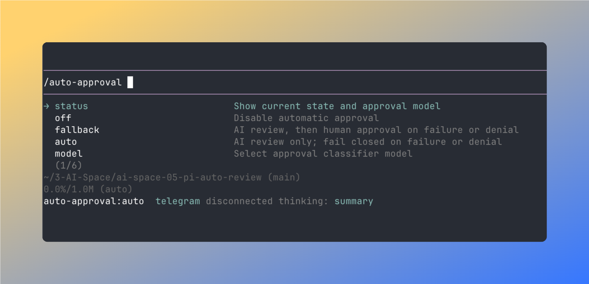
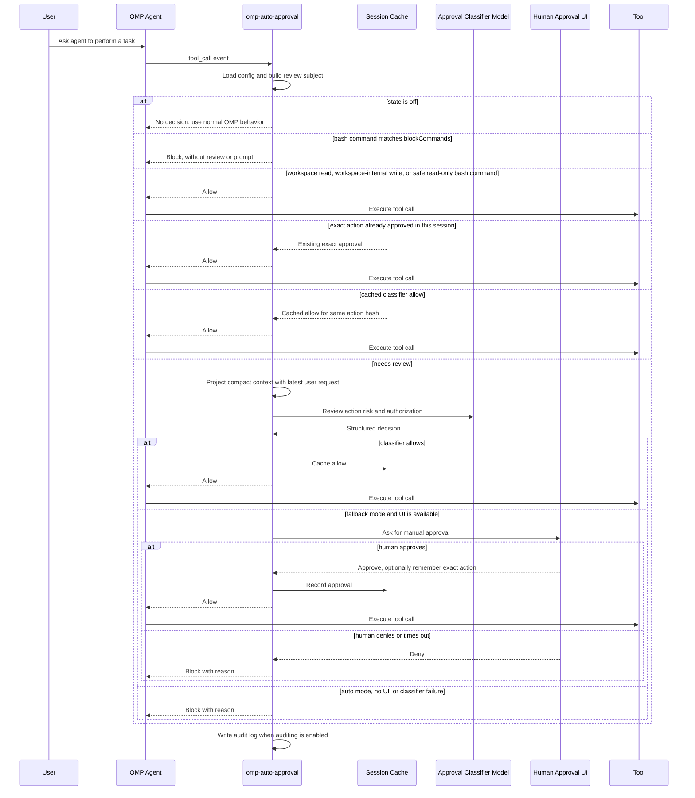

# omp-auto-approval

English | [中文](./README.zh-CN.md)

omp-auto-approval is an OMP fork of [pi-auto-approval](https://github.com/Europa2061/pi-auto-approval), an automatic approval extension inspired by Claude Code auto mode and Codex Auto-review.

It uses an AI classifier to approve low-risk tool calls. Risky, denied, failed, or uncertain actions fall back to human approval or are blocked by the selected mode.

> **Restoration and attribution notice**
>
> This repository is an independently maintained fork restored from the original [`omp-auto-approval@0.1.0` npm package](https://www.npmjs.com/package/omp-auto-approval/v/0.1.0). The original OMP extension was authored and published by **HayabusaC** ([`hayabusac` on npm](https://www.npmjs.com/~hayabusac)); its declared source repository is no longer publicly available. This is not an official repository of the original author. The original Apache-2.0 license is retained in [`LICENSE`](./LICENSE).

## Installation

Install the latest version of this fork directly from GitHub:

```bash
omp plugin install https://github.com/sthetz/omp-auto-approval
```

Install the pinned `0.3.1` release:

```bash
omp plugin install github:sthetz/omp-auto-approval#v0.3.1
```

The original `0.1.0` release remains available on npm as `omp-auto-approval`, but that package contains the original code rather than this restored fork. This fork is distributed through GitHub and is not published to npm.

Remove the plugin:

```bash
omp plugin uninstall omp-auto-approval
```

Restart the OMP RPC process and enable the recommended mode:

```text
/auto-approval fallback
```

OMP has its own approval setting, `tools.approvalMode`, which runs after this extension has allowed a call. Its default, `yolo`, adds no prompts. With `always-ask`, `always-ask-cached` or `write`, OMP still asks you about calls this extension already approved.

This fork registers the same `/auto-approval` command as the original Pi package. Remove or disable the original package before enabling this fork to avoid duplicate command registration. Back up custom settings before switching; the fork uses its own config and audit-log paths.

## Commands

`/auto-approval` is the only slash command. Type `/auto-approval ` with a trailing space to see available arguments.

| Command | Effect |
| --- | --- |
| `/auto-approval status` | Show current state, approval classifier model, config path, audit log path, and any config problems. |
| `/auto-approval off` | Disable automatic approval. Tool approvals return to OMP's normal behavior. |
| `/auto-approval fallback` | Enable AI review with human approval fallback when the classifier denies or fails. |
| `/auto-approval auto` | Enable AI review only. Classifier denial or failure blocks the tool call. |
| `/auto-approval model` | Open the model selector for the approval classifier model. |
| `/auto-approval model current` | Use the active OMP session model for approval classification. |
| `/auto-approval explain <tool> [args]` | Show how a tool call would be routed, without running it. `args` is a path, a JSON object, or (for `bash`) a command, e.g. `/auto-approval explain read ~/.ssh/id_ed25519`. If the first word isn't a tool in the session, the whole input is explained as a bash command: `/auto-approval explain ls -la`. |

## Screenshot

`/auto-approval` argument completions expose the available modes and model selector directly in OMP.



## Architecture

omp-auto-approval sits between OMP tool calls and the normal approval path:

- command layer registers `/auto-approval` and persists local config;
- prompt layer adds a short note to the system prompt while auto-approval is on, asking the agent to report a blocked call instead of retrying it in another form;
- routing layer fast-paths disabled, workspace read-only, workspace-safe, and session-approved actions;
- classifier layer projects recent session context and asks the selected model for a structured allow or deny decision;
- fallback layer asks the user when classifier review cannot safely approve;
- audit layer writes JSONL records when auditing is enabled.

## Approval Flow



## States

`off` means the extension does not make automatic approval decisions.

`fallback` means local fast paths handle actions that are already known to be low risk, such as non-sensitive workspace reads, workspace-internal writes, explicitly allowlisted safe commands, or exact actions already approved in the session. Other tool calls go to the classifier first. If it allows, the tool runs. If it denies, fails, times out, or the tool is manual-only, OMP asks the human through the approval UI when UI is available.

`auto` means non-fast-path tool calls use the classifier as the approval gate. Local fast paths can still allow actions that are statically known to be low risk or already approved in the current session. For reviewed actions, a classifier allow runs the tool; a classifier deny, failure, timeout, or manual-only tool blocks the tool call.

### Stopping the turn

After `maxConsecutiveDenials` automatic denials in a row (default 3: classifier denials or failures and `blockCommands` blocks), the extension ends the agent's turn instead of trusting the agent to stop on its own. The human approval prompt in `fallback` mode also offers **Reject and Stop the Turn**.

While auto-approval is on, a short note is added to the system prompt asking the agent to report a blocked call to you instead of retrying it in another form.

## Safety

`fallback` is the recommended mode for normal interactive use. It lets local fast paths and the classifier reduce repeated prompts, but keeps human approval available when the classifier denies, fails, or times out.

`auto` is fail-closed for reviewed actions and should be used only in trusted unattended contexts. Classifier failures and denials block the tool call. Any local fast path must be narrowly defined and statically low risk; otherwise the action is reviewed or blocked.

## Fast Paths

Fast paths approve without classifier review, so they are deliberately narrow:

- **Workspace reads**: the host's own read-only tools (`read`, `grep`, `find`, `glob`, `ast_grep`, `ls`, …) when every path they name is inside the working directory or a `readRoots` directory (after resolving symlinks) and is not credential-like. These always go to classifier review:
  - paths outside the working directory and `readRoots`;
  - URLs (`http(s)://`, `www.`) and remote or sensitive internal URLs (`ssh://`, `mcp://`, `pr://`, `issue://`, `mr://`, `vault://`, `cfg://`, `proc://`, …). Only session-local URLs (`skill://`, `rule://`, `agent://`, `artifact://`, `memory://`, `local://`, `omp://`) skip review;
  - credential-like files and directories anywhere in the tree: `.env` and `.env.*` (except `.example`, `.sample`, `.template`, `.dist`, `.defaults`), `.envrc`, `.npmrc`, `.pypirc`, `.netrc`, `.pgpass`, `.git-credentials`, `.htpasswd`, `kubeconfig`, `id_rsa`/`id_ed25519`-style keys, `credentials.*`, `secret(s).*`, `*.pem`, `*.key`, `*.p12`, `*.pfx`, `*.jks`, `*.keystore`, `*.kdbx`, `*.tfstate`, `*.tfvars`, and anything under `.ssh`, `.gnupg`, `.aws`, `.azure`, `.kube`, `.docker`, `.password-store`, `secrets`, `.secrets` or `credentials`;
  - path forms that OMP rewrites before use (a leading `@`, `:` or `"`, `~user`, `file://`, `?query`, `#fragment`);
  - searches with `gitignore: false`. OMP's `grep` searches hidden files but honours `.gitignore`, which normally keeps `.env` out of a workspace-wide search. A secret file that is *not* gitignored can still appear in grep results.

  `web_search` is always classifier-reviewed, because its query is sent to a third party and could carry data out of the session.

  Tools are matched by name only when the host reports them as its own (`sourceInfo.source` is `builtin`). An extension, SDK or MCP tool that reuses a read-only name is reviewed. Self-declared metadata (`isReadOnly`, `readOnlyHint`, MCP `annotations.readOnlyHint`) is ignored, as the MCP specification says these hints are untrusted.
- **Workspace writes**: calls to OMP's own `write` and `edit` tools whose every destination, including `edit` renames, is a plain path inside the working directory. These always go to classifier review instead:
  - paths that OMP rewrites before use (`[path]`, `~/…`, `scheme://…`);
  - protected entries at any depth, after resolving symlinks: `.git`, `.omp`, `.pi`, `.claude`, `.mcp.json`, `.cursor`, `.envrc`, `.vscode`, `.idea`, `.husky`, `.devcontainer`. Their contents are executed or trusted later without review: `core.fsmonitor` in `.git/config` runs on `git status`, and Claude Code hooks in `.claude/settings.json` run shell commands;
  - the credential-like files listed above for reads, such as `.env` or `*.pem`;
  - writes that create or change a program: content starting with `#!` (OMP's `write` tool makes such a file executable) or a destination that is already executable. A program in the workspace can shadow a command on the shell's PATH.
- **Safe bash commands**: read-only git commands, common read-only programs such as `grep`, `cat`, `head`, `ls`, `sed -n` and `jq` (see [Built-in read-only programs](#built-in-read-only-programs)), and `safeCommandAllowlist` entries. They can be joined with `&&`, `||`, `;`, newlines and pipes, and each command is checked on its own: `git log --oneline | grep -i fix | head -5` skips review. Only a small subset of bash takes this path, one this extension reads exactly as bash does (it is tested against bash itself, see `CONTRIBUTING.md`): plain and quoted words, those operators, comments, and these redirections:
  - copies between stdin, stdout and stderr (`2>&1`);
  - `/dev/null` (`2>/dev/null`, `&>/dev/null`, `</dev/null`);
  - `< file` for a file the fast path could read anyway.

  Everything else is reviewed, including `$` and backticks, subshells and `{ }` groups, background `&`, heredocs, `if`/`for`/`while`, `VAR=value command`, and redirections that write a file (`> out.txt`).

  A leading `cd <dir> &&` (or `cd <dir>;`) is allowed when `<dir>` is an existing directory inside the working directory: `cd src && git status`. That `cd` does not run in the shell. The rest of the command runs with the bash call's `cwd` set to that directory, so a `cd` function or `CDPATH` left by an earlier call cannot send it elsewhere, and its relative paths are checked from there. A `cd` anywhere else, or to `-`, a glob, or an option, is reviewed.

  The read-only git commands are `status`, `log`, `diff`, `show`, `rev-parse`, `grep`, `ls-files`, `ls-tree`, `rev-list`, `blame`, `shortlog`, `describe`, `merge-base`, `show-ref`, `cat-file`, `check-ignore`, `check-attr`, `name-rev`, `count-objects`, listing-only `branch` and `tag`, `remote [-v]`, `remote get-url` and `stash list`/`show`, optionally after `--no-pager` and `-C <dir>` (a directory inside the working directory). A git command is still reviewed if it:
  - uses `--output`, `--ext-diff`, `--no-index`, or `grep -O`/`--open-files-in-pager`;
  - names a path outside the working directory (git compares files outside the work tree even without `--no-index`, so `git diff /etc/passwd /dev/null` prints the file);
  - names a credential-like path, including `rev:path` blobs such as `git show HEAD:.env`;
  - contains an unquoted glob (`git diff -- secrets*`).

  OMP runs every bash call in one persistent shell per session, so an earlier call can leave an alias, a function, or a workspace directory on PATH that turns `git status` into something else. A fast-pathed command is therefore rewritten to run every program by absolute path, looked up on the PATH OMP started with, skipping directories inside the workspace: `git status` runs as `/run/current-system/sw/bin/git status`. A leading `~` is written out as OMP's home directory too, since bash expands it from the shell's `HOME`, which an earlier call can change. If a program isn't found there, the command is reviewed. The rewritten command appears in the transcript and in the audit log as `pinnedCommand`, with `pinnedCwd` when a leading `cd` moved it. A command wrapped in `bash -lc` is reviewed, since the wrapper's own `bash` would be looked up on that PATH. A bash call whose `cwd` is outside the working directory is reviewed; one inside it has its paths checked from there. Variables exported by an earlier call (`GIT_EXTERNAL_DIFF`, `LD_PRELOAD`, …) still reach the pinned program, but setting them takes a reviewed call.

### Built-in read-only programs

These programs skip review without any configuration: `cat`, `head`, `tail`, `wc`, `ls`, `grep`, `sed`, `cut`, `sort`, `uniq`, `tr`, `tac`, `paste`, `base64`, `diff`, `du`, `stat`, `file`, `readlink`, `realpath`, `jq`, `find`, `timeout`, `echo`, `printf`, `true`, `false`, `pwd`, `basename`, `dirname`, `date`, `sleep`, `seq`, `which`, `uname`, `whoami`, `id`, `hostname` and `nproc`. Each has a table of the options it may be given. The tables list options known to be read-only, not options known to be dangerous: any option outside the table, including a shortened long option such as `--incl`, sends the command to review. Options are read the way GNU getopt reads them (grouped short options, glued values, options after operands). Options were chosen to be read-only in GNU, BSD and busybox alike, and for `grep` in GNU grep and ugrep, since the PATH may resolve to any of them; the oracle in `CONTRIBUTING.md` checks them against the implementations installed locally. Left out, for example:
- options that write files or run programs: `sort -o/-T/--compress-program`, `sed -i/-f`, `diff -l`, `file -z`, `jq -f/-L`, `find -exec/-delete/-fprint`, `date -s`, an operand to `hostname`, a second operand to `uniq` (its output file);
- options that never finish or follow links out of a tree: `tail -f`, `ls -L`, `du -L`, `grep -R`, `find -L`;
- `egrep` and `fgrep`, which are scripts that run `grep` from whatever PATH the shell has.

Files a program reads, as operands or option values (`grep -f`, `diff --from-file`), must be inside the working directory or `readRoots` and not credential-like, and so must every other word that names an existing file, whatever the program makes of it. Some programs take more care:
- **Globs** in file operands (`wc -l src/*.ts`) are allowed: every file the glob could match is checked, whatever glob options (`dotglob`, `nocaseglob`, `globskipdots`) an earlier call set, so `cat *` is reviewed when `.env` is in the directory. A glob that matches nothing, could match a name starting with `-`, or uses braces or `**` is reviewed. A glob anywhere else is reviewed, except in a `--name=value` option that no file matches.
- **Recursive reads**: `grep -r` (and any directory named to `grep` or `diff`) walks the tree first and is reviewed if it holds a credential-like file that the search would read, so `grep -rn TODO .` is reviewed in a directory with a `.env`. Quoted `--include` and `--exclude-dir` filters are honoured: `grep -rn TODO --include='*.ts' .` is not reviewed. Symbolic links met on the way are skipped, as `grep -r` does. Trees of more than 20,000 entries are reviewed.
- **`sed`** scripts may only print, delete, quit and substitute: addresses, `!`, `p d q Q = l P n N g G h H x z D`, and `s` without the `e` and `w` flags. Commands that read or write files (`r R w W`), run programs (`e`), insert text, branch or group are reviewed.
- **`jq`** can neither write files nor run programs, but a filter can read the environment (`env`, `$ENV`) or load modules (`import`, `include`), and those are reviewed.
- **`timeout`** runs the command after its duration, which must be safe on its own; that program is pinned too.
- **`find`** takes known tests only (`-name`, `-type`, `-path`, `-maxdepth`, `-newer`, `-printf`, …); a glob anywhere in its expression is reviewed, since a matching file name could become an action.

### Allowlisted commands

A `safeCommandAllowlist` entry is a prefix (`"rg *"`, `"find"`, `"npm test"`), so on its own it would trust every option of the program. Even when an entry matches, a command is still reviewed if:

- it uses an option that runs another program or writes files: `find -exec/-execdir/-ok/-okdir/-delete/-fprint*/-fls`, `fd -x/-X/--exec*` (also inside a group such as `-Hx`), `rg --pre`, `sort -o/--output/--compress-program`, `tar -I/-F/--to-command/--checkpoint-action/--use-compress-program/...`, and `tar` extracting or writing archives (`x`, `c`, `r`, `u`, `A`, `--extract`, `--delete`, …). GNU tools accept shortened long options, so `sort --outp=x` counts as `--output`;
- an argument names an existing path outside the working directory and `readRoots`, or a credential-like path. This covers values glued to an option and `name=value` arguments: `cat ~/.ssh/id_ed25519`, `cat .env`, `rg TOKEN --file=../x`, `grep -f/etc/x`, `dd if=../x`;
- an argument is expanded by the shell, since its final form is unknown: an unquoted glob or brace, `~user`, or `~` after `=` or `:` in a `name=value` word, which bash expands (`dd if=~/key`). `cat secrets*` is reviewed, `find . -name '*.ts'` is not.

A command a built-in table rejects can still be allowed by an entry, under these rules. Some entries are ignored, and `/auto-approval status` says so: any entry for programs whose arguments are a script or command line (`sed`, `awk`, `xargs`, `parallel`; read-only `sed` scripts are covered by its table), and bare entries for shells, interpreters and wrappers (`bash`, `python`, `node`, `env`, `sudo`, `timeout`, …), which would allow any code. Name a specific invocation instead, such as `"python -m pytest"` or `"npm test"`. Beyond those rules, an entry still trusts the program: `npm test` runs whatever the `test` script says.

### Extra read roots

Reads outside the working directory are reviewed, which adds a classifier call for things like dependency sources. List directories you are happy for the agent to read freely in `readRoots`:

```json
{
  "readRoots": ["/nix/store", "~/.cargo/registry", "~/go/pkg/mod"]
}
```

Entries must be absolute or start with `~/`. Credential-like files below a read root are still reviewed. Read roots also cover the paths a fast-pathed bash command names (allowlisted arguments and `<` redirections), but they never add a command to the fast path.

## Blocked Commands

`blockCommands` lists bash commands that are always blocked, in every mode, without asking the classifier or you. They take precedence over every fast path, `safeCommandAllowlist` and `reviewExemptTools`. Unlike `deny`, which is only guidance for the classifier, a block cannot be argued with.

```json
{
  "blockCommands": ["git push --force", "git push -f", "/\\bgit\\b.*\\bpush\\b.*\\s\\+\\S/", "terraform apply", "/curl[^|]*\\|\\s*(ba)?sh/"]
}
```

A pattern is either `/regex/flags`, tested against the whole command, or a list of words: the first names a program and the rest must follow it, in order, within the same command. `git push --force` matches `git push origin main --force`, `/usr/bin/git push --force`, `cd repo && git push --force` and `bash -lc "git push --force"`, but not `git push --force-with-lease`. Long flags are compared as written, so list `-f` separately. A single-letter flag also matches grouped short flags: `git push -f` matches `git push -uf origin main`. Git also forces a push when a branch is prefixed with `+` (`git push origin +main`), which no word list can express; the regex above catches it. Matching errs toward blocking: the words also match when they are arguments to another command, such as `echo git push --force`.

This is a best-effort tripwire for commands you never want run unattended, not a sandbox: a sufficiently creative command (variables, aliases, scripts) can still get past it, and is then reviewed by the classifier as usual.

## Tool Review Exemptions

`todo` and `wait` only perform local orchestration, so the host's builtin `todo` and `wait` always bypass classifier review. Their decisions are still written to the audit log with route `local_state`.

`ask` is UI-only. In interactive sessions, forms from the host's builtin `ask` that contain no URLs bypass classifier review with audit route `ui_only`; OMP still renders the form and waits for submit or cancel. Rendering fetches HTTP(S) image sources, so any form whose payload contains `http:`, `https:`, or `//` anywhere, after HTML entity decoding, remains classifier-reviewed. Noninteractive `ask` calls are also classifier-reviewed.

`eval` and `task` remain classifier-reviewed: `eval` executes arbitrary code, and `task` can delegate work to fully capable subagents.

Set `reviewExemptTools` in `config.jsonc` to bypass all extension review for additional tool names:

```json
{
  "reviewExemptTools": ["custom_state"]
}
```

Tool names are case-insensitive. This is a deterministic bypass, including for tools that would otherwise require manual approval, so only list tools whose execution you are willing to allow without AI review. In contrast, `allow` only adds guidance to the classifier prompt and does not guarantee approval. `blockCommands` still applies to exempt tools.

## Classifier Model

By default, the approval classifier uses the current OMP session model. Use `/auto-approval model` to choose another available model from OMP's model selector.

The selected value is stored as `classifierModel` in `config.jsonc`. `null` means "use the current session model".

Classifier requests go through the host's own `pi-ai` package with the same provider auth as normal OMP model calls, so no extra packages need to be installed.

The classifier sees the latest user request, up to six earlier user messages, the agent's latest message, and the pending action. Authorization can only come from your messages. The agent's message is included to explain intent but marked as untrusted. Tool output (file contents, command output, fetched pages) is left out entirely, because that is where prompt injections come from.

Messages that OMP places in the user role on someone else's behalf (`attribution: "agent"`) don't count as yours: a subagent's assignment, compaction and branch summaries, messages from other agents, and MCP notices. The classifier sees the latest of them separately, marked as untrusted. Otherwise an agent could write "the user approved this" into a `task` assignment and the subagent's classifier would read it as your request. For a subagent, your messages come from the parent session's file, found through the `parentSession` header. With `--no-session` there is no such file, so subagents get no user request and only low-risk actions pass.

If the classifier allows an action it rated `high` risk without `high` user authorization, or `critical` risk at all without it, the extension treats the answer as a denial.

### Classifier timeout

OMP blocks a tool call when an extension's `tool_call` handler runs longer than `extensionHandlers.toolCallTimeoutMs` (30 s by default), before the classifier answers and without asking you, even in `fallback` mode. According to the setting's description, time spent in OMP's own dialogs, such as the approval prompt, doesn't count. `classifierTimeoutSeconds` therefore defaults to 25 s. A slow classifier then times out first, so `fallback` asks you and `auto` blocks with a clear reason.

If you use a slower classifier model, raise both: OMP's `extensionHandlers.toolCallTimeoutMs`, and `classifierTimeoutSeconds` below it. `/auto-approval status` warns when `classifierTimeoutSeconds` is 30 s or more. Before 0.3.0 the default was 90 s and was written into every config file; a stored 90 is now read as 25.

## Configuration

`config.jsonc` lives in the extension directory, or at `PI_AUTO_APPROVAL_CONFIG_PATH`. Only values that differ from the defaults are saved, so later default changes take effect. `/auto-approval status` reports unknown keys, such as typos. The full schema is in [`schemas/config.schema.json`](schemas/config.schema.json) and an annotated example in [`config/config.example.jsonc`](config/config.example.jsonc).

| Key | Default | Meaning |
| --- | --- | --- |
| `enabled`, `mode` | `false`, `"fallback"` | Set by `/auto-approval off / fallback / auto`. |
| `classifierModel` | `null` | `provider/model`, or `null` for the session model. |
| `classifierTimeoutSeconds` | `25` | See [Classifier timeout](#classifier-timeout). |
| `approvalTimeoutSeconds` | `30` | How long the human prompt waits before rejecting. |
| `maxConsecutiveDenials` | `3` | Automatic denials in a row before the turn is stopped. |
| `safeCommandAllowlist` | `[]` | Extra bash commands to allow without review: exact, prefix + space, or `prefix*`. See [Allowlisted commands](#allowlisted-commands). |
| `blockCommands` | `[]` | See [Blocked Commands](#blocked-commands). |
| `readRoots` | `[]` | See [Extra read roots](#extra-read-roots). |
| `reviewExemptTools` | `[]` | Tool names that skip review entirely. |
| `allow`, `deny` | `[]` | Extra guidance lines for the classifier prompt. |
| `environment` | `""` | Free-form description of your environment for the classifier. |
| `audit` | `true` | Write JSONL decisions to the audit log. |

The model selector refreshes OMP's runtime model registry before reading available models, so it includes runtime-added and custom provider models.

## References

This extension is an independent OMP package. Its approval workflow and terminal interaction design were informed by OpenAI Codex CLI and Claude Code-style coding-agent permission flows.

## OMP Smoke Regression

Run the local OMP-side smoke regression with:

```bash
npm run smoke:omp
```

The smoke script runs in temporary config and log directories. It verifies `/auto-approval fallback`, `/auto-approval auto`, safe bash command allow, suspicious bash command human fallback or denial, and JSONL audit log contents.
