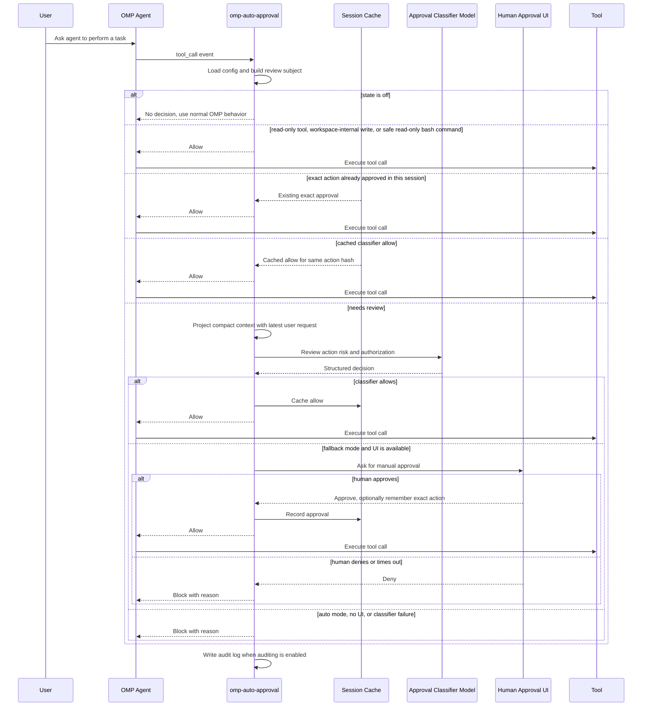

# omp-auto-approval

English | [中文](./README.zh-CN.md)

omp-auto-approval is an OMP fork of [pi-auto-approval](https://github.com/Europa2061/pi-auto-approval), an automatic approval extension inspired by Claude Code auto mode and Codex Auto-review.

It uses an AI classifier to approve low-risk tool calls. Risky, denied, failed, or uncertain actions fall back to human approval or are blocked by the selected mode.

> **Restoration and attribution notice**
>
> This repository is an independently maintained fork restored from the original [`omp-auto-approval@0.1.0` npm package](https://www.npmjs.com/package/omp-auto-approval/v/0.1.0). The original OMP extension was authored and published by **HayabusaC** ([`hayabusac` on npm](https://www.npmjs.com/~hayabusac)); its declared source repository is no longer publicly available. This is not an official repository of the original author. The original Apache-2.0 license is retained in [`LICENSE`](./LICENSE).

## Installation

Install the latest version of this fork directly from GitHub:

```bash
omp plugin install https://github.com/sthetz/omp-auto-approval
```

Install the pinned `0.2.1` release:

```bash
omp plugin install github:sthetz/omp-auto-approval#v0.2.1
```

The original `0.1.0` release remains available on npm as `omp-auto-approval`, but that package contains the original code rather than this restored fork. This fork is distributed through GitHub and is not published to npm.

Remove the plugin:

```bash
omp plugin uninstall omp-auto-approval
```

Restart the OMP RPC process and enable the recommended mode:

```text
/auto-approval fallback
```

This fork registers the same `/auto-approval` command as the original Pi package. Remove or disable the original package before enabling this fork to avoid duplicate command registration. Back up custom settings before switching; the fork uses its own config and audit-log paths.

## Commands

`/auto-approval` is the only slash command. Type `/auto-approval ` with a trailing space to see available arguments.

| Command | Effect |
| --- | --- |
| `/auto-approval status` | Show current state, approval classifier model, config path, and audit log path. |
| `/auto-approval off` | Disable automatic approval. Tool approvals return to OMP's normal behavior. |
| `/auto-approval fallback` | Enable AI review with human approval fallback when the classifier denies or fails. |
| `/auto-approval auto` | Enable AI review only. Classifier denial or failure blocks the tool call. |
| `/auto-approval model` | Open the model selector for the approval classifier model. |
| `/auto-approval model current` | Use the active OMP session model for approval classification. |

## Screenshot

`/auto-approval` argument completions expose the available modes and model selector directly in OMP.


## Architecture

omp-auto-approval sits between OMP tool calls and the normal approval path:

- command layer registers `/auto-approval` and persists local config;
- routing layer fast-paths disabled, read-only, workspace-safe, and session-approved actions;
- classifier layer projects recent session context and asks the selected model for a structured allow or deny decision;
- fallback layer asks the user when classifier review cannot safely approve;
- audit layer writes JSONL records when auditing is enabled.

## Approval Flow



## States

`off` means the extension does not make automatic approval decisions.

`fallback` means local fast paths handle actions that are already known to be low risk, such as trusted read-only tools, workspace-internal writes, explicitly allowlisted safe commands, or exact actions already approved in the session. Other tool calls go to the classifier first. If it allows, the tool runs. If it denies, fails, times out, or the tool is manual-only, OMP asks the human through the approval UI when UI is available.

`auto` means non-fast-path tool calls use the classifier as the approval gate. Local fast paths can still allow actions that are statically known to be low risk or already approved in the current session. For reviewed actions, a classifier allow runs the tool; a classifier deny, failure, timeout, manual-only tool, or repeated denial blocks the tool call.

## Safety

`fallback` is the recommended mode for normal interactive use. It lets local fast paths and the classifier reduce repeated prompts, but keeps human approval available when the classifier denies, fails, or times out.

`auto` is fail-closed for reviewed actions and should be used only in trusted unattended contexts. Classifier failures and denials block the tool call. Any local fast path must be narrowly defined and statically low risk; otherwise the action is reviewed or blocked.

## Fast Paths

Fast paths approve without classifier review, so they are deliberately narrow:

- **Read-only tools**: tools with trusted read-only metadata and the built-in read-only tool names (`read`, `grep`, `find`, `ls`, …).
- **Workspace writes**: `write` and `edit` calls whose every destination, including `edit` renames, is a plain path inside the working directory. Paths that OMP rewrites before use (`[path]`, `~/…`, `scheme://…`) and protected entries (`.git`, `.omp`, `.pi`, `.envrc`, `.vscode`, at any depth, after resolving symlinks) always go to classifier review, because their contents are executed or trusted without further review. For example, `core.fsmonitor` in `.git/config` runs on `git status`.
- **Safe bash commands**: `pwd`, `git status`, `git log`, `git diff`, `git show`, `git rev-parse`, and listing-only `git branch`, plus `safeCommandAllowlist` entries. A command containing a newline, `&`, `|`, `;`, `<`, `>`, `` ` ``, or `$` is never fast-pathed. Neither is a git command using `--output` or `--ext-diff`.

## Tool Review Exemptions

`todo` and `wait` only perform local orchestration, so they always bypass classifier review. Their decisions are still written to the audit log with route `local_state`.

`ask` is UI-only. In interactive sessions, forms without URLs bypass classifier review with audit route `ui_only`; OMP still renders the form and waits for submit or cancel. Rendering fetches HTTP(S) image sources, so any form whose payload contains `http:`, `https:`, or `//` anywhere, after HTML entity decoding, remains classifier-reviewed. Noninteractive `ask` calls are also classifier-reviewed.

`eval` and `task` remain classifier-reviewed: `eval` executes arbitrary code, and `task` can delegate work to fully capable subagents.

Set `reviewExemptTools` in `config.jsonc` to bypass all extension review for additional tool names:

```json
{
  "reviewExemptTools": ["custom_state"]
}
```

Tool names are case-insensitive. This is a deterministic bypass, including for tools that would otherwise require manual approval, so only list tools whose execution you are willing to allow without AI review. In contrast, `allow` only adds guidance to the classifier prompt and does not guarantee approval.

## Classifier Model

By default, the approval classifier uses the current OMP session model. Use `/auto-approval model` to choose another available model from OMP's model selector.

The selected value is stored as `classifierModel` in `config.jsonc`. `null` means "use the current session model".

Classifier requests go through the host's own `pi-ai` package with the same provider auth as normal OMP model calls, so no extra packages need to be installed.

The model selector refreshes OMP's runtime model registry before reading available models, so it includes runtime-added and custom provider models.

## References

This extension is an independent OMP package. Its approval workflow and terminal interaction design were informed by OpenAI Codex CLI and Claude Code-style coding-agent permission flows.

## OMP Smoke Regression

Run the local OMP-side smoke regression with:

```bash
npm run smoke:omp
```

The smoke script runs in temporary config and log directories. It verifies `/auto-approval fallback`, `/auto-approval auto`, safe bash command allow, suspicious bash command human fallback or denial, and JSONL audit log contents.
