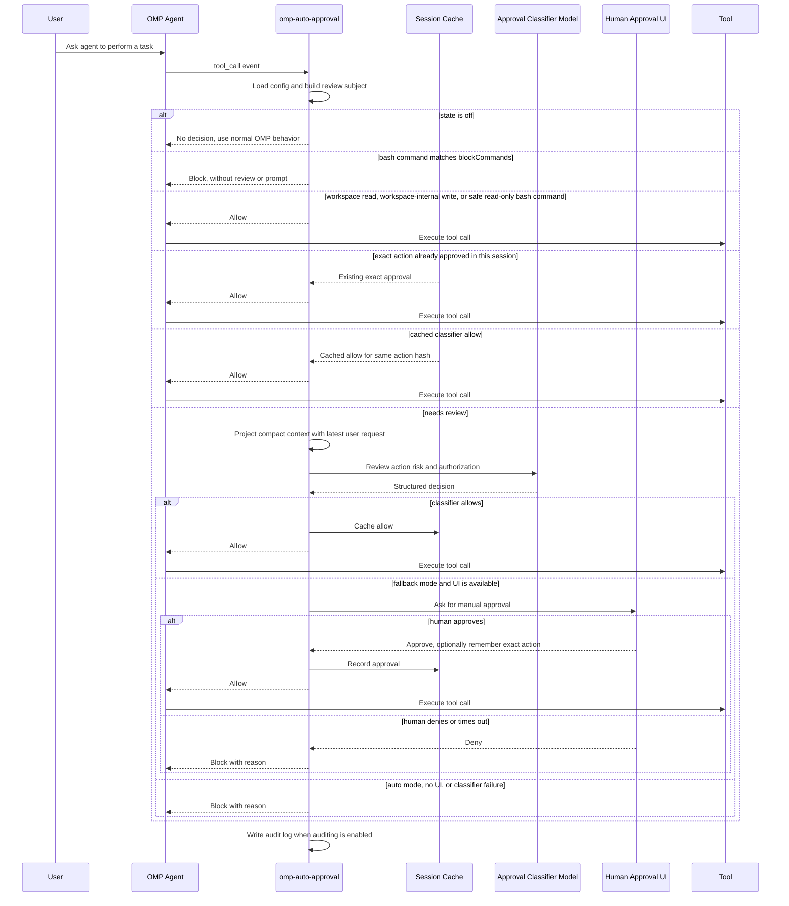

# omp-auto-approval

English | [中文](./README.zh-CN.md)

omp-auto-approval is an OMP fork of [pi-auto-approval](https://github.com/Europa2061/pi-auto-approval), an automatic approval extension inspired by Claude Code auto mode and Codex Auto-review.

It uses an AI classifier to approve low-risk tool calls. Risky, denied, failed, or uncertain actions fall back to human approval or are blocked by the selected mode.

> **Restoration and attribution notice**
>
> This repository is an independently maintained fork restored from the original [`omp-auto-approval@0.1.0` npm package](https://www.npmjs.com/package/omp-auto-approval/v/0.1.0). The original OMP extension was authored and published by **HayabusaC** ([`hayabusac` on npm](https://www.npmjs.com/~hayabusac)); its declared source repository is no longer publicly available. This is not an official repository of the original author. The original Apache-2.0 license is retained in [`LICENSE`](./LICENSE).

## Installation

Install the latest version of this fork directly from GitHub:

```bash
omp plugin install https://github.com/sthetz/omp-auto-approval
```

Install the pinned `0.2.2` release:

```bash
omp plugin install github:sthetz/omp-auto-approval#v0.2.2
```

The original `0.1.0` release remains available on npm as `omp-auto-approval`, but that package contains the original code rather than this restored fork. This fork is distributed through GitHub and is not published to npm.

Remove the plugin:

```bash
omp plugin uninstall omp-auto-approval
```

Restart the OMP RPC process and enable the recommended mode:

```text
/auto-approval fallback
```

OMP has its own approval setting, `tools.approvalMode`, which runs after this extension has allowed a call. Its default, `yolo`, adds no prompts. With `always-ask`, `always-ask-cached` or `write`, OMP still asks you about calls this extension already approved.

This fork registers the same `/auto-approval` command as the original Pi package. Remove or disable the original package before enabling this fork to avoid duplicate command registration. Back up custom settings before switching; the fork uses its own config and audit-log paths.

## Commands

`/auto-approval` is the only slash command. Type `/auto-approval ` with a trailing space to see available arguments.

| Command | Effect |
| --- | --- |
| `/auto-approval status` | Show current state, approval classifier model, config path, audit log path, and any config problems. |
| `/auto-approval off` | Disable automatic approval. Tool approvals return to OMP's normal behavior. |
| `/auto-approval fallback` | Enable AI review with human approval fallback when the classifier denies or fails. |
| `/auto-approval auto` | Enable AI review only. Classifier denial or failure blocks the tool call. |
| `/auto-approval model` | Open the model selector for the approval classifier model. |
| `/auto-approval model current` | Use the active OMP session model for approval classification. |
| `/auto-approval explain <tool> [args]` | Show how a tool call would be routed, without running it. `args` is a path, a JSON object, or (for `bash`) a command, e.g. `/auto-approval explain read ~/.ssh/id_ed25519`. |

## Screenshot

`/auto-approval` argument completions expose the available modes and model selector directly in OMP.


## Architecture

omp-auto-approval sits between OMP tool calls and the normal approval path:

- command layer registers `/auto-approval` and persists local config;
- prompt layer adds a short note to the system prompt while auto-approval is on, asking the agent to report a blocked call instead of retrying it in another form;
- routing layer fast-paths disabled, workspace read-only, workspace-safe, and session-approved actions;
- classifier layer projects recent session context and asks the selected model for a structured allow or deny decision;
- fallback layer asks the user when classifier review cannot safely approve;
- audit layer writes JSONL records when auditing is enabled.

## Approval Flow



## States

`off` means the extension does not make automatic approval decisions.

`fallback` means local fast paths handle actions that are already known to be low risk, such as non-sensitive workspace reads, workspace-internal writes, explicitly allowlisted safe commands, or exact actions already approved in the session. Other tool calls go to the classifier first. If it allows, the tool runs. If it denies, fails, times out, or the tool is manual-only, OMP asks the human through the approval UI when UI is available.

`auto` means non-fast-path tool calls use the classifier as the approval gate. Local fast paths can still allow actions that are statically known to be low risk or already approved in the current session. For reviewed actions, a classifier allow runs the tool; a classifier deny, failure, timeout, or manual-only tool blocks the tool call.

### Stopping the turn

After `maxConsecutiveDenials` automatic denials in a row (default 3: classifier denials or failures and `blockCommands` blocks), the extension ends the agent's turn instead of trusting the agent to stop on its own. The human approval prompt in `fallback` mode also offers **Reject and Stop the Turn**.

While auto-approval is on, a short note is added to the system prompt asking the agent to report a blocked call to you instead of retrying it in another form.

## Safety

`fallback` is the recommended mode for normal interactive use. It lets local fast paths and the classifier reduce repeated prompts, but keeps human approval available when the classifier denies, fails, or times out.

`auto` is fail-closed for reviewed actions and should be used only in trusted unattended contexts. Classifier failures and denials block the tool call. Any local fast path must be narrowly defined and statically low risk; otherwise the action is reviewed or blocked.

## Fast Paths

Fast paths approve without classifier review, so they are deliberately narrow:

- **Workspace reads**: the host's own read-only tools (`read`, `grep`, `find`, `glob`, `ast_grep`, `ls`, …) when every path they name is inside the working directory or a `readRoots` directory (after resolving symlinks) and is not credential-like. These always go to classifier review:
  - paths outside the working directory and `readRoots`;
  - URLs (`http(s)://`, `www.`) and remote or sensitive internal URLs (`ssh://`, `mcp://`, `pr://`, `issue://`, `mr://`, `vault://`, `cfg://`, `proc://`, …). Only session-local URLs (`skill://`, `rule://`, `agent://`, `artifact://`, `memory://`, `local://`, `omp://`) skip review;
  - credential-like files and directories anywhere in the tree: `.env` and `.env.*` (except `.example`, `.sample`, `.template`, `.dist`, `.defaults`), `.envrc`, `.npmrc`, `.pypirc`, `.netrc`, `.pgpass`, `.git-credentials`, `.htpasswd`, `kubeconfig`, `id_rsa`/`id_ed25519`-style keys, `credentials.*`, `secret(s).*`, `*.pem`, `*.key`, `*.p12`, `*.pfx`, `*.jks`, `*.keystore`, `*.kdbx`, `*.tfstate`, `*.tfvars`, and anything under `.ssh`, `.gnupg`, `.aws`, `.azure`, `.kube`, `.docker`, `.password-store`, `secrets`, `.secrets` or `credentials`;
  - path forms that OMP rewrites before use (a leading `@`, `:` or `"`, `~user`, `file://`, `?query`, `#fragment`);
  - searches with `gitignore: false`. OMP's `grep` searches hidden files but honours `.gitignore`, which normally keeps `.env` out of a workspace-wide search. A secret file that is *not* gitignored can still appear in grep results.

  `web_search` is always classifier-reviewed, because its query is sent to a third party and could carry data out of the session.

  Tools are matched by name only when the host reports them as its own (`sourceInfo.source` is `builtin`). An extension, SDK or MCP tool that reuses a read-only name is reviewed. Self-declared metadata (`isReadOnly`, `readOnlyHint`, MCP `annotations.readOnlyHint`) is ignored, as the MCP specification says these hints are untrusted.
- **Workspace writes**: `write` and `edit` calls whose every destination, including `edit` renames, is a plain path inside the working directory. Paths that OMP rewrites before use (`[path]`, `~/…`, `scheme://…`) and protected entries (`.git`, `.omp`, `.pi`, `.envrc`, `.vscode`, at any depth, after resolving symlinks) always go to classifier review, because their contents are executed or trusted without further review. For example, `core.fsmonitor` in `.git/config` runs on `git status`.
- **Safe bash commands**: `pwd`, `git status`, `git log`, `git diff`, `git show`, `git rev-parse`, and listing-only `git branch`, plus `safeCommandAllowlist` entries. A command containing a newline, `&`, `|`, `;`, `<`, `>`, `` ` ``, or `$` is never fast-pathed. Neither is a git command that:
  - uses `--output`, `--ext-diff` or `--no-index`;
  - names a path outside the working directory (git compares files outside the work tree even without `--no-index`, so `git diff /etc/passwd /dev/null` prints the file);
  - names a credential-like path, including `rev:path` blobs such as `git show HEAD:.env`.

### Extra read roots

Reads outside the working directory are reviewed, which adds a classifier call for things like dependency sources. List directories you are happy for the agent to read freely in `readRoots`:

```json
{
  "readRoots": ["/nix/store", "~/.cargo/registry", "~/go/pkg/mod"]
}
```

Entries must be absolute or start with `~/`. Credential-like files below a read root are still reviewed. Read roots apply only to read-only tools, not to bash commands.

## Blocked Commands

`blockCommands` lists bash commands that are always blocked, in every mode, without asking the classifier or you. They take precedence over every fast path, `safeCommandAllowlist` and `reviewExemptTools`. Unlike `deny`, which is only guidance for the classifier, a block cannot be argued with.

```json
{
  "blockCommands": ["git push --force", "git push -f", "terraform apply", "/curl[^|]*\\|\\s*(ba)?sh/"]
}
```

A pattern is either `/regex/flags`, tested against the whole command, or a list of words: the first names a program and the rest must follow it, in order, within the same command. `git push --force` matches `git push origin main --force`, `/usr/bin/git push --force`, `cd repo && git push --force` and `bash -lc "git push --force"`, but not `git push --force-with-lease`. Flags are compared as written, so list `-f` separately. Matching errs toward blocking: the words also match when they are arguments to another command, such as `echo git push --force`.

This is a best-effort tripwire for commands you never want run unattended, not a sandbox: a sufficiently creative command (variables, aliases, scripts) can still get past it, and is then reviewed by the classifier as usual.

## Tool Review Exemptions

`todo` and `wait` only perform local orchestration, so the host's builtin `todo` and `wait` always bypass classifier review. Their decisions are still written to the audit log with route `local_state`.

`ask` is UI-only. In interactive sessions, forms from the host's builtin `ask` that contain no URLs bypass classifier review with audit route `ui_only`; OMP still renders the form and waits for submit or cancel. Rendering fetches HTTP(S) image sources, so any form whose payload contains `http:`, `https:`, or `//` anywhere, after HTML entity decoding, remains classifier-reviewed. Noninteractive `ask` calls are also classifier-reviewed.

`eval` and `task` remain classifier-reviewed: `eval` executes arbitrary code, and `task` can delegate work to fully capable subagents.

Set `reviewExemptTools` in `config.jsonc` to bypass all extension review for additional tool names:

```json
{
  "reviewExemptTools": ["custom_state"]
}
```

Tool names are case-insensitive. This is a deterministic bypass, including for tools that would otherwise require manual approval, so only list tools whose execution you are willing to allow without AI review. In contrast, `allow` only adds guidance to the classifier prompt and does not guarantee approval. `blockCommands` still applies to exempt tools.

## Classifier Model

By default, the approval classifier uses the current OMP session model. Use `/auto-approval model` to choose another available model from OMP's model selector.

The selected value is stored as `classifierModel` in `config.jsonc`. `null` means "use the current session model".

Classifier requests go through the host's own `pi-ai` package with the same provider auth as normal OMP model calls, so no extra packages need to be installed.

The classifier sees the latest user request, up to six earlier user messages, the agent's latest message, and the pending action. Authorization can only come from your messages. The agent's message is included to explain intent but marked as untrusted. Tool output (file contents, command output, fetched pages) is left out entirely, because that is where prompt injections come from.

If the classifier allows an action it rated `high` risk without `high` user authorization, or `critical` risk at all without it, the extension treats the answer as a denial.

### Classifier timeout

OMP blocks a tool call when an extension's `tool_call` handler runs longer than `extensionHandlers.toolCallTimeoutMs` (30 s by default), before the classifier answers and without asking you, even in `fallback` mode. According to the setting's description, time spent in OMP's own dialogs, such as the approval prompt, doesn't count. `classifierTimeoutSeconds` therefore defaults to 25 s. A slow classifier then times out first, so `fallback` asks you and `auto` blocks with a clear reason.

If you use a slower classifier model, raise both: OMP's `extensionHandlers.toolCallTimeoutMs`, and `classifierTimeoutSeconds` below it. `/auto-approval status` warns when `classifierTimeoutSeconds` is 30 s or more. Before 0.3.0 the default was 90 s and was written into every config file; a stored 90 is now read as 25.

## Configuration

`config.jsonc` lives in the extension directory, or at `PI_AUTO_APPROVAL_CONFIG_PATH`. Only values that differ from the defaults are saved, so later default changes take effect. `/auto-approval status` reports unknown keys, such as typos. The full schema is in [`schemas/config.schema.json`](schemas/config.schema.json) and an annotated example in [`config/config.example.jsonc`](config/config.example.jsonc).

| Key | Default | Meaning |
| --- | --- | --- |
| `enabled`, `mode` | `false`, `"fallback"` | Set by `/auto-approval off / fallback / auto`. |
| `classifierModel` | `null` | `provider/model`, or `null` for the session model. |
| `classifierTimeoutSeconds` | `25` | See [Classifier timeout](#classifier-timeout). |
| `approvalTimeoutSeconds` | `30` | How long the human prompt waits before rejecting. |
| `maxConsecutiveDenials` | `3` | Automatic denials in a row before the turn is stopped. |
| `safeCommandAllowlist` | `[]` | Extra bash commands to allow without review: exact, prefix + space, or `prefix*`. |
| `blockCommands` | `[]` | See [Blocked Commands](#blocked-commands). |
| `readRoots` | `[]` | See [Extra read roots](#extra-read-roots). |
| `reviewExemptTools` | `[]` | Tool names that skip review entirely. |
| `allow`, `deny` | `[]` | Extra guidance lines for the classifier prompt. |
| `environment` | `""` | Free-form description of your environment for the classifier. |
| `audit` | `true` | Write JSONL decisions to the audit log. |

The model selector refreshes OMP's runtime model registry before reading available models, so it includes runtime-added and custom provider models.

## References

This extension is an independent OMP package. Its approval workflow and terminal interaction design were informed by OpenAI Codex CLI and Claude Code-style coding-agent permission flows.

## OMP Smoke Regression

Run the local OMP-side smoke regression with:

```bash
npm run smoke:omp
```

The smoke script runs in temporary config and log directories. It verifies `/auto-approval fallback`, `/auto-approval auto`, safe bash command allow, suspicious bash command human fallback or denial, and JSONL audit log contents.
