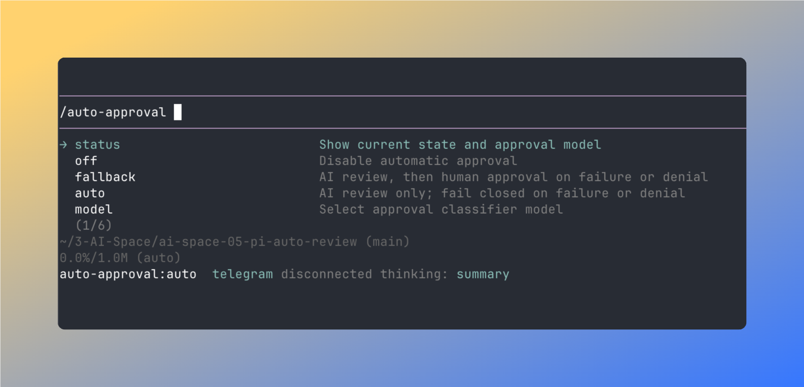
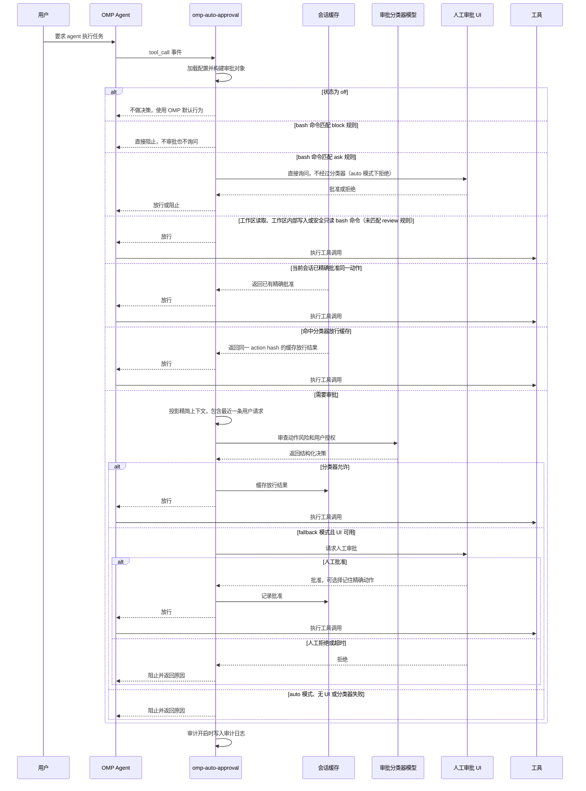

# omp-auto-approval

[English](./README.md) | 中文

omp-auto-approval 是 [pi-auto-approval](https://github.com/Europa2061/pi-auto-approval) 的 OMP 分支，提供受 Claude Code auto mode 和 Codex Auto-review 启发的自动审批功能。

当 OMP agent 请求执行工具调用时，扩展会用 AI 分类器判断能否安全放行。低风险动作会自动批准；高风险、拒绝、失败或不确定的动作，会按当前模式回退到人工审批或直接阻止。

## 安装

直接从 GitHub 安装此分支的最新版本：

```bash
omp plugin install https://github.com/sthetz/omp-auto-approval
```

安装固定为 `0.3.1` 的版本：

```bash
omp plugin install github:sthetz/omp-auto-approval#v0.3.1
```

原始 `0.1.0` 版本仍以 `omp-auto-approval` 的名称发布在 npm 上，但该包包含原始代码，而不是此恢复分支。此分支通过 GitHub 分发，不发布到 npm。

卸载插件：

```bash
omp plugin uninstall omp-auto-approval
```

重启 OMP RPC 进程并启用推荐模式：

```text
/auto-approval fallback
```

OMP 自带审批设置 `tools.approvalMode`，它在本扩展放行调用之后运行。默认值 `yolo` 不会额外询问。若设为 `always-ask`、`always-ask-cached` 或 `write`，OMP 仍会对本扩展已批准的调用再次询问你。

此分支和原版都会注册 `/auto-approval` 命令。启用本分支前请移除或禁用原版，避免命令重复注册。如需保留自定义设置，请先备份；本分支使用独立的配置和审计日志路径。

## 命令

`/auto-approval` 是唯一的斜杠命令。输入带尾随空格的 `/auto-approval ` 可以查看可用参数。

| 命令 | 效果 |
| --- | --- |
| `/auto-approval status` | 显示当前状态、审批分类器模型、配置文件路径、审计日志路径以及配置问题。 |
| `/auto-approval off` | 关闭自动审批。工具审批回到 OMP 的默认行为。 |
| `/auto-approval fallback` | 开启 AI 审批；当分类器拒绝或失败时，回退到人工审批。 |
| `/auto-approval auto` | 只使用 AI 审批。分类器拒绝或失败时直接阻止工具调用。 |
| `/auto-approval model` | 打开审批分类器模型选择器。 |
| `/auto-approval model current` | 使用当前 OMP 会话模型作为审批分类器模型。 |
| `/auto-approval rules [程序 \| 规则 id]` | 列出正在使用的命令规则及其来源文件，或显示某个程序的条目或某条规则。见[自定义命令规则](#自定义命令规则)。 |
| `/auto-approval explain <tool> [args]` | 显示某个工具调用会走哪条审批路由，但不执行它。`args` 可以是路径、JSON 对象，或（对 `bash`）命令，例如 `/auto-approval explain read ~/.ssh/id_ed25519`。如果第一个单词不是当前会话中的工具，整段输入会被当作 bash 命令解释：`/auto-approval explain ls -la`。 |

## 截图

`/auto-approval` 参数补全会直接在 OMP 中展示可用模式和模型选择入口。



## 架构

omp-auto-approval 位于 OMP 工具调用和默认审批路径之间：

- 命令层注册 `/auto-approval` 并持久化本地配置；
- 提示词层在自动审批开启时向系统提示词追加一段简短说明，要求代理在调用被阻止时如实报告，而不是换一种方式重试；
- 路由层快速处理关闭、工作区只读、工作区安全、会话已批准等动作；
- 分类器层投影最近会话上下文，并让选定模型返回结构化允许或拒绝决策；
- 兜底层在分类器无法安全放行时请求人工审批；
- 审计层在启用审计时写入 JSONL 记录。

## 审批流程



## 状态

`off` 表示扩展不做自动审批决策。

`fallback` 表示本地 fast path 会先处理已知低风险动作，例如非敏感的工作区读取、工作区内写入、命令规则允许的命令，或当前会话中已批准过的精确动作。其他工具调用会先交给分类器审批。如果分类器允许，工具会执行。如果分类器拒绝、失败、超时，或工具必须人工审批，并且 UI 可用，OMP 会通过审批 UI 询问人工确认。

`auto` 表示非 fast-path 工具调用由分类器作为审批关口。本地 fast path 仍然可以允许静态可证明低风险或当前会话已批准的动作。对于进入审批的动作，分类器允许时工具执行；分类器拒绝、失败、超时，或工具必须人工审批时，工具调用会被阻止。

### 结束当前轮次

连续出现 `maxConsecutiveDenials` 次自动拒绝（默认 3 次：分类器拒绝或失败，以及 ask 和 block 规则的拒绝）后，扩展会直接结束代理的当前轮次，而不是指望代理自己停下。`fallback` 模式下的人工审批界面也提供 **Reject and Stop the Turn**。

自动审批开启时，系统提示词中会追加一段简短说明，要求代理在调用被阻止时向你报告，而不是换一种方式重试。

## 安全提示

普通交互使用推荐 `fallback`。它通过本地 fast path 和分类器减少重复确认，但分类器拒绝、失败或超时时仍会保留人工审批兜底。

`auto` 对进入审批的动作是失败即拒绝模式，只建议在可信的无人值守场景中使用。分类器失败或拒绝都会阻止工具调用。任何本地 fast path 都必须保持窄范围，并且能静态证明低风险；否则动作必须进入审批或被阻止。

## Fast Path

Fast path 不经分类器审批直接放行，因此范围刻意保持狭窄：

- **工作区读取**：宿主自带的只读工具（`read`、`grep`、`find`、`glob`、`ast_grep`、`ls` 等），且其指定的每个路径（解析符号链接后）都位于工作目录或 `readRoots` 目录内、并且不像凭据文件。以下情况始终进入分类器审批：
  - 工作目录和 `readRoots` 之外的路径；
  - URL（`http(s)://`、`www.`）以及远程或敏感的内部 URL（`ssh://`、`mcp://`、`pr://`、`issue://`、`mr://`、`vault://`、`cfg://`、`proc://` 等）。只有会话本地 URL（`skill://`、`rule://`、`agent://`、`artifact://`、`memory://`、`local://`、`omp://`）可以跳过审批；
  - 目录树中任意位置的凭据类文件和目录：`.env` 和 `.env.*`（`.example`、`.sample`、`.template`、`.dist`、`.defaults` 除外）、`.envrc`、`.npmrc`、`.pypirc`、`.netrc`、`.pgpass`、`.git-credentials`、`.htpasswd`、`kubeconfig`、`id_rsa`/`id_ed25519` 类私钥、`credentials.*`、`secret(s).*`、`*.pem`、`*.key`、`*.p12`、`*.pfx`、`*.jks`、`*.keystore`、`*.kdbx`、`*.tfstate`、`*.tfvars`，以及 `.ssh`、`.gnupg`、`.aws`、`.azure`、`.kube`、`.docker`、`.password-store`、`secrets`、`.secrets`、`credentials` 目录下的任何内容；
  - OMP 会在使用前改写的路径形式（开头的 `@`、`:` 或 `"`，`~user`，`file://`，`?query`，`#fragment`）；
  - 设置了 `gitignore: false` 的搜索。OMP 的 `grep` 会搜索隐藏文件，但遵守 `.gitignore`，因此通常不会在全工作区搜索中读到 `.env`。*未*被 gitignore 的密钥文件仍可能出现在 grep 结果中。

  `web_search` 始终需要分类器审批，因为它的查询会发送给第三方，可能把数据带出会话。

  只有宿主报告为自身工具（`sourceInfo.source` 为 `builtin`）时才按工具名匹配。扩展、SDK 或 MCP 工具即使复用了只读工具名也需要审批。工具自行声明的元数据（`isReadOnly`、`readOnlyHint`、MCP `annotations.readOnlyHint`）会被忽略，因为 MCP 规范说明这些提示不可信。
- **工作区写入**：OMP 自身的 `write` 和 `edit` 工具调用，且所有目标路径（包括 `edit` 的重命名目标）都是工作目录内的普通路径。以下情况始终进入分类器审批：
  - OMP 会在使用前改写的路径（`[path]`、`~/…`、`scheme://…`）；
  - 任意层级、解析符号链接后的受保护条目：`.git`、`.omp`、`.pi`、`.claude`、`.mcp.json`、`.cursor`、`.envrc`、`.vscode`、`.idea`、`.husky`、`.devcontainer`。它们的内容之后会被直接执行或信任：`.git/config` 中的 `core.fsmonitor` 会在 `git status` 时运行，`.claude/settings.json` 中的 Claude Code hooks 会执行 shell 命令；
  - 上文读取部分列出的凭据类文件，例如 `.env` 或 `*.pem`；
  - 创建或修改程序的写入：内容以 `#!` 开头（OMP 的 `write` 工具会把这样的文件设为可执行），或目标文件已经可执行。工作区中的程序可能在 shell 的 PATH 上遮蔽某个命令。
- **安全 bash 命令**：只读 git 命令、`grep`、`cat`、`head`、`ls`、`sed -n`、`jq` 等常见只读程序（见[内置只读程序](#内置只读程序)），以及 allow 规则指定的命令。它们可以用 `&&`、`||`、`;`、换行和管道连接，每条命令会被单独检查：`git log --oneline | grep -i fix | head -5` 无需审批。只有一个很小的 bash 子集会走这条路径，本扩展对它的解读与 bash 完全一致（已用 bash 本身测试，见 `CONTRIBUTING.md`）：普通单词和带引号的单词、上述操作符、注释，以及以下重定向：
  - 标准输入、标准输出和标准错误之间的复制（`2>&1`）；
  - `/dev/null`（`2>/dev/null`、`&>/dev/null`、`</dev/null`）；
  - 对 fast path 本来就能读取的文件使用 `< file`。

  其他一切都需要审批，包括 `$` 和反引号、子 shell 和 `{ }` 分组、后台 `&`、heredoc、`if`/`for`/`while`、`VAR=value command`，以及写入文件的重定向（`> out.txt`）。

  开头的 `cd <dir> &&`（或 `cd <dir>;`）在 `<dir>` 是工作目录内已存在的目录时允许：`cd src && git status`。这个 `cd` 不会在 shell 中运行。命令的其余部分会在 bash 调用的 `cwd` 设为该目录后运行，因此之前调用留下的 `cd` 函数或 `CDPATH` 无法把它带到别处，其相对路径也从该目录检查。出现在其他位置的 `cd`，或目标为 `-`、通配符或选项的 `cd`，都需要审批。

  只读 git 命令包括 `status`、`log`、`diff`、`show`、`rev-parse`、`grep`、`ls-files`、`ls-tree`、`rev-list`、`blame`、`shortlog`、`describe`、`merge-base`、`show-ref`、`cat-file`、`check-ignore`、`check-attr`、`name-rev`、`count-objects`、仅列出的 `branch` 和 `tag`、`remote [-v]`、`remote get-url` 以及 `stash list`/`show`，前面可以有 `--no-pager` 和 `-C <dir>`（工作目录内的目录）。以下 git 命令仍需审批：
  - 使用 `--output`、`--ext-diff`、`--no-index`，或 `grep -O`/`--open-files-in-pager`；
  - 指定工作目录之外的路径（即使不加 `--no-index`，git 也会比较工作树之外的文件，因此 `git diff /etc/passwd /dev/null` 会输出该文件）；
  - 指定凭据类路径，包括 `git show HEAD:.env` 这类 `rev:path` 对象；
  - 某个选项指向工作目录和 `readRoots` 之外的已有文件，例如紧贴在 `-O` 后的排序文件（`git diff -O/path/order`）；
  - 包含未加引号的通配符（`git diff -- secrets*`）。

  OMP 在每个会话中用同一个持久 shell 运行所有 bash 调用，因此之前的调用可能留下别名、函数，或把工作区目录加入 PATH，让 `git status` 变成别的东西。因此走 fast path 的命令会被改写为按绝对路径运行其中的每个程序：在 OMP 启动时的 PATH 中查找，并跳过工作区内的目录，例如 `git status` 以 `/run/current-system/sw/bin/git status` 运行。开头的 `~` 也会被写成 OMP 的主目录，因为 bash 从 shell 的 `HOME` 展开它，而之前的调用可以修改 `HOME`。如果在那里找不到某个程序，命令需要审批。改写后的命令会出现在对话记录中，并以 `pinnedCommand` 写入审计日志；如果开头的 `cd` 改变了目录，还会写入 `pinnedCwd`。用 `bash -lc` 包装的命令需要审批，因为包装层自己的 `bash` 会在那个 PATH 上查找。`cwd` 位于工作目录之外的 bash 调用需要审批；位于其内的调用会从该目录检查路径。之前调用导出的变量（`GIT_EXTERNAL_DIFF`、`LD_PRELOAD` 等）仍会传给固定路径的程序，但设置它们需要一次经过审批的调用。

  有些 shell 状态会在之后的每条命令之前或之后自行运行代码，固定路径无法阻止：`trap … DEBUG` 会在固定路径的程序之前运行，也会在放在它前面的任何内容之前运行。因此，一旦运行过可能设置这类钩子的 bash 命令（无论经由哪条路由，或在扩展关闭时），本会话剩余时间内的所有 bash 命令都需要审批，OMP 会显示警告。这包括 `trap`、`eval`、`exec`、`enable`、由变量命名的命令（`$cmd`，除非同一条命令把它设为纯文本）、设置为这些命令的别名或变量、`PS4`、`BASH_ENV`、`PROMPT_COMMAND`、`extdebug` 和 `functrace`，以及对无法读取或包含上述内容的文件执行 `source`/`.`。路径为字面量的被 source 文件会以同样方式读取和检查，因此 `source .venv/bin/activate` 仍可走 fast path。heredoc 的内容是命令的输入，不会被检查。在约 15,000 条记录下来的 agent 命令中，有 1.7% 会关闭 fast path。`/auto-approval status` 和 `explain` 会说明 fast path 何时关闭；新会话会重新打开它，`/auto-approval off` 不会。该检查读取的是文本，所以分段拼出的钩子（`$'\x74rap'`）可能绕过它；设置钩子的命令本身仍会先经过审批。

  如果 bash 调用带有改变其运行方式或位置的字段，也需要审批：`pty: true`（标准输入是终端）、`async`、带有 `ready`/`log`/`port`/`host` 的服务 `name`、`env`，或扩展不认识的任何字段。只允许 `command`、`cwd`、`timeout` 和 `description`。

### 内置只读程序

以下程序无需任何配置即可免审批：`cat`、`head`、`tail`、`wc`、`ls`、`grep`、`sed`、`cut`、`sort`、`uniq`、`tr`、`tac`、`paste`、`base64`、`diff`、`du`、`stat`、`file`、`readlink`、`realpath`、`jq`、`find`、`timeout`、`echo`、`printf`、`true`、`false`、`pwd`、`basename`、`dirname`、`date`、`sleep`、`seq`、`which`、`uname`、`whoami`、`id`、`hostname` 和 `nproc`。每个程序都有一张允许使用的选项表，git 还有一份子命令列表；它们都在 [`config/default-rules.jsonc`](config/default-rules.jsonc) 中，刻意排除的选项附有注释。表中列出的是已知只读的选项，而不是已知危险的选项：表外的任何选项，包括 `--incl` 这类缩写的长选项，都会让命令进入审批。选项按 GNU getopt 的方式解析（组合短选项、紧贴的值、操作数之后的选项）。由于 PATH 可能解析到任何一种实现，选项的挑选标准是在 GNU、BSD 和 busybox 中都只读，`grep` 的选项在 GNU grep 和 ugrep 中也只读；`CONTRIBUTING.md` 中的 oracle 会用本地安装的实现检查它们。例如以下内容不在表中：
- 写文件或运行程序的选项：`sort -o/-T/--compress-program`、`sed -i/-f`、`diff -l`、`file -z`、`jq -f/-L`、`find -exec/-delete/-fprint`、`date -s`、`hostname` 的操作数、`uniq` 的第二个操作数（它的输出文件）；
- 永不结束或沿符号链接离开目录树的选项：`tail -f`、`ls -L`、`du -L`、`grep -R`、`find -L`；
- `egrep` 和 `fgrep`：它们是从 shell 当前的 PATH 中运行 `grep` 的脚本。

程序读取的文件，无论是操作数还是选项值（`grep -f`、`diff --from-file`），都必须位于工作目录或 `readRoots` 内且不是凭据类文件；其他任何指向已存在文件的单词也一样，不管程序如何理解它。有些程序需要更多处理：
- **通配符**可以用在文件操作数中（`wc -l src/*.ts`）：通配符可能匹配的每个文件都会被检查，不论之前的调用设置了哪些通配选项（`dotglob`、`nocaseglob`、`globskipdots`），因此目录中有 `.env` 时 `cat *` 需要审批。不匹配任何文件、可能匹配以 `-` 开头的名称，或使用花括号或 `**` 的通配符需要审批。其他位置的通配符需要审批，除非它在一个没有文件匹配的 `--name=value` 选项中。
- **递归读取**：`grep -r`（以及传给 `grep` 或 `diff` 的任何目录）会先遍历目录树，如果其中有搜索会读到的凭据类文件就需要审批，因此在含有 `.env` 的目录中 `grep -rn TODO .` 需要审批。带引号的 `--include` 和 `--exclude-dir` 过滤会被考虑：`grep -rn TODO --include='*.ts' .` 无需审批。遍历中遇到的符号链接会被跳过，与 `grep -r` 一致。超过 20,000 个条目的目录树需要审批。
- **`sed`** 脚本只能打印、删除、退出和替换：地址、`!`、`p d q Q = l P n N g G h H x z D`，以及不带 `e` 和 `w` 标志的 `s`。读写文件（`r R w W`）、运行程序（`e`）、插入文本、跳转或分组的命令需要审批。
- **`jq`** 既不能写文件也不能运行程序，但过滤器可以读取环境（`env`、`$ENV`）或加载模块（`import`、`include`），这些需要审批。
- **`timeout`** 运行时长之后的命令，该命令本身必须安全；它的程序也会被固定为绝对路径。
- **`find`** 只接受已知的测试（`-name`、`-type`、`-path`、`-maxdepth`、`-newer`、`-printf` 等）；表达式中任何位置的通配符都需要审批，因为匹配到的文件名可能变成一个动作。

### 自定义命令规则

`config.jsonc` 旁边的 `rules.jsonc`（或 `PI_AUTO_APPROVAL_RULES_PATH` 指定的文件）会叠加在内置规则之上，格式与 [`config/default-rules.jsonc`](config/default-rules.jsonc) 相同。[`config/rules.example.jsonc`](config/rules.example.jsonc) 是一个带注释的示例：它让 `kubectl get`、`describe` 和 `logs` 免审批（但 `kubectl get secrets` 除外），并修改了几个内置条目。

- 你自己写的程序条目会**替换**内置条目。加上 `"extends": "default"` 则改为**合并**进内置条目：选项和子命令逐个键合并，`null` 删除一个内置键（必须与内置文件中的写法完全一致，例如 `"-n --lines"`）；`except` 列表会合并；其他键替换内置值。
- `"disable": ["program:sed", "program:git blame"]` 移除内置条目。
- 含多个名字的键（例如 `"get describe"`）表示共享同一条目的多个子命令。子命令的子命令不能单独成为条目，所以 `"worktree list"` 表示 `worktree` 和 `list` 两个子命令；若只想允许 `git worktree list`，请给 `worktree` 设置操作数检查 `{ "literals": { "min": 1, "max": 1, "pattern": "^list$" } }`，示例文件中就是这样写的。
- `"include": ["~/…/kubectl.jsonc"]` 读取更多文件，路径须为绝对路径或以 `~/` 开头。每个程序只能在一个文件中定义。
- 条目未列出的选项和子命令仍需审批，与内置规则相同；代码中的所有检查也照常生效：程序从 OMP 启动时的 PATH 中运行，文件只能在可读目录内读取，等等。
- 只要其中任何一个文件有错误（未知的键、类型或检查、重复列出的选项、无效的 include），就不会使用任何规则：由于文件中可能有 block 或 ask 规则，在错误修复之前，每条 bash 命令都会先询问你（在 `auto` 模式下或没有交互界面时直接拒绝）。OMP 会在会话开始时显示错误，`/auto-approval status` 会显示正在使用的文件或错误；修复文件后，执行任何 `/auto-approval` 命令即可重新加载。
- 这些文件在会话开始时以及执行任何 `/auto-approval` 命令时读取。写入快速通道永远不会写入它们或 `config.jsonc`，即使它们位于工作目录中。

没有按项目区分的规则文件：克隆下来的仓库可能会自带一个。

#### allow、review、ask 与 block 规则

程序条目通过读取选项和操作数来决定哪些命令可以免审批。`rules` 列表则按命令文本添加规则：

```jsonc
"rules": [
  { "id": "npm-test", "prefix": "npm test", "outcome": "allow" },
  { "id": "kube-secrets", "match": "kubectl get|describe *[Ss][Ee][Cc][Rr][Ee][Tt]*", "outcome": "review",
    "why": "Secret values must not reach the model unreviewed." },
  { "id": "kube-interactive", "match": "kubectl exec|port-forward|cp|edit|apply|rollout", "outcome": "ask" },
  { "id": "no-force-push", "match": ["git push --force", "git push -f", "/\\bgit\\b.*\\bpush\\b.*\\s\\+\\S/"], "outcome": "block" }
]
```

- `allow`：以 `prefix` 开头的命令免审批，检查见 [allow 规则](#allow-规则)。
- `review`：交给分类器，然后按模式交给你，与其他需审批的命令相同；永远不走快速通道。
- `ask`：由你决定，不经过分类器。在 `auto` 模式下或没有交互界面时，命令会被拒绝。选择“Allow Always This Exact Action”后，本会话内完全相同的命令不再询问。
- `block`：在任何模式下直接拒绝，既不询问分类器，也不询问你。`deny` 只是给分类器的指导，而 block 无法被说服。

在命令匹配到的规则中，最严格的一项生效：block，其次 ask，再次 review。任何一项都优先于程序条目、allow 规则和 `reviewExemptTools`，因此宽泛的允许永远不会掩盖例外。ask 和 block 的拒绝计入 `maxConsecutiveDenials`。`why` 会显示在拒绝原因和审批提示中，并作为你的理由提供给分类器。`id` 必须唯一；`disable` 可按 id 移除内置规则（见[内置规则](#内置规则)）。

`/auto-approval rules` 列出正在使用的程序和规则及其来源文件；`/auto-approval rules <程序 | 规则 id>` 显示其中一项。`explain` 会给出起决定作用的规则，审计日志将其记录为 `ruleId` 和 `ruleSource`（对于走快速通道的命令，放行它的条目记录为 `ruleIds`）。

#### 模式

`match` 是一个模式或模式列表。模式可以是 `/regex/flags`（对整条命令做匹配），也可以是一串单词：第一个单词是程序名，其余单词需按顺序出现在同一条命令中。`git push --force` 能匹配 `git push origin main --force`、`/usr/bin/git push --force`、`cd repo && git push --force` 和 `bash -lc "git push --force"`，但不匹配 `git push --force-with-lease`。单词中：

- `a|b` 表示多选，`*`、`?` 和 `[…]` 是通配符；`[|]`、`[*]` 等匹配字符本身；
- `--name` 同时匹配 `--name=value`，但不匹配缩写的 `--na`，如果程序接受缩写，请分别列出；
- 单字母参数也能匹配合并的短参数：`git push -f` 能匹配 `git push -uf origin main`。

在分支前加 `+`（`git push origin +main`）同样会强制推送，单词列表无法表达这种形式，上例中的正则表达式可以捕获它。程序按名称匹配，因此请写 `git` 而不是 `/usr/bin/git`。

单词按 bash 的方式读取：引号会把单词保持在一起，因此引号中的 `;` 或 `|`（`git -c 'x=a;b' push --force`）以及反斜杠换行都无法隐藏命令，而提到 `git push --force` 的提交信息只是一个单词，不是一次推送。循环、`$(…)` 以及交给 shell 执行的脚本（`bash -lc '…'`、`eval '…'`、输入给 `bash` 的 heredoc）中的命令也会被读取。多单词模式中的程序可以出现在命令的任何位置（`sudo`、`docker exec c`、`ssh host` 之后）；`sudo` 或 `mkfs*` 这类单个单词的模式只在程序运行的位置匹配，因此 `which sudo` 不会匹配。

只有忽略引号时才匹配的模式（`ssh host "git reset --hard"`，但也包括 `echo "git reset --hard"`）无法区分命令和普通文字，因此该命令会被审查，而不是被阻止或询问。正则表达式按原文读取整条命令并保留其结果，因此内置的 block 规则不使用正则。

由变量或命令替换指定的程序（`$k delete --all`、`$(command -v kubectl) delete --all`）可能是任何程序：在程序运行的位置，它会匹配多单词模式，只要其余单词随后出现。同一条命令中设为纯文本的变量会按该文本读取，因此 `X=helm; $X delete --all` 不会匹配 `kubectl delete --all`。规则只是尽力而为的绊线，而不是沙箱：别名、函数或脚本仍然可以绕过规则，此时它照常交给分类器审批。

#### 内置规则

[`config/default-rules.jsonc`](config/default-rules.jsonc) 自带一些规则，针对在任何终端工作中都很少适合由代理独自运行的命令：

| id | 结果 | 匹配 |
| --- | --- | --- |
| `force-push` | block | `git push --force`、`-f`、`+branch` |
| `rm-root-or-home` | block | 对 `/`、`/*`、`~` 或 `$HOME` 的 `rm -r`；`rm --no-preserve-root` |
| `format-disk` | block | `mkfs*`、`wipefs`、`dd of=/dev/sd*` 及其他磁盘设备 |
| `pipe-to-shell` | ask | 把 `curl …` 或 `wget …` 管道给 shell |
| `git-discard` | ask | `git reset --hard`、`git clean -f`、`git checkout .`、`git restore .`、`git stash drop`/`clear` |
| `git-overwrite-remote` | ask | `git push --force-with-lease`、`--delete`、`:branch`；`git branch -D` |
| `privilege` | ask | `sudo`、`doas`、`su`、`pkexec` |
| `publish` | ask | `npm`/`pnpm`/`yarn`/`bun publish`、`cargo publish`、`twine upload`、`poetry`/`uv publish`、`gem push`、`docker`/`podman push`、`gh release create` 等 |
| `power` | ask | `shutdown`、`reboot`、`poweroff`、`halt`、`systemctl reboot` 等 |
| `database-drop` | ask | 通过 `psql`、`mysql`、`sqlite3` 等 `DROP` 或 `TRUNCATE` 数据库、schema 或表 |
| `infrastructure` | review | `terraform`/`tofu apply`/`destroy`、`pulumi up`/`destroy`、`kubectl delete`/`drain`、`helm uninstall` |

`infrastructure` 采用审查而不是询问：基础设施工作中经常运行这些命令，分类器可以根据对话（以及规则给出的理由）作出判断。若要修改内置规则，请禁用它并添加自己的规则：`"disable": ["infrastructure"], "rules": [{ "id": "infrastructure-ask", "match": "kubectl delete|drain", "outcome": "ask" }]`。

### allow 规则

allow 规则的 `prefix` 是按原样书写的命令开头（包含引号，不含重定向）：命令必须与它相同或在其后接一个空格；带结尾 `*` 时，只需以其余部分开头（`"rg *"` 匹配 `rg x`，但不匹配单独的 `rg`）。链或管道中的每条命令都需要各自的规则或程序条目。由于前缀会信任该程序的所有选项，以下命令仍需审批：

- 使用会运行其他程序或写文件的选项：`find -exec/-execdir/-ok/-okdir/-delete/-fprint*/-fls`、`fd -x/-X/--exec*`（也包括 `-Hx` 这类组合）、`rg --pre`、`sort -o/--output/--compress-program`、`tar -I/-F/--to-command/--checkpoint-action/--use-compress-program/...`，以及解压或写入归档的 `tar`（`x`、`c`、`r`、`u`、`A`、`--extract`、`--delete` 等）。GNU 工具接受缩写的长选项，因此 `sort --outp=x` 视同 `--output`；
- 某个参数指向工作目录和 `readRoots` 之外的已有路径，或凭据类路径。这包括紧贴在选项后的值和 `name=value` 参数：`cat ~/.ssh/id_ed25519`、`cat .env`、`rg TOKEN --file=../x`、`grep -f/etc/x`、`dd if=../x`；
- 某个参数会被 shell 展开，最终形式未知：未加引号的通配符或花括号、`~user`，或 `name=value` 中 `=` 或 `:` 之后的 `~`（bash 会展开它，例如 `dd if=~/key`）。`cat secrets*` 需要审批，`find . -name '*.ts'` 不需要。

被程序条目拒绝的命令仍可以在这些检查下由规则放行。为参数是脚本或命令行的程序（`sed`、`awk`、`xargs`、`parallel`；只读的 `sed` 脚本由其条目覆盖），或为 shell、解释器和包装器本身（`bash`、`python`、`node`、`env`、`sudo`、`timeout` 等，会允许任意代码）写的前缀是错误。请写出具体的调用方式，例如 `"python -m pytest"` 或 `"npm test"`。紧贴在单词后的 `*` 表示该单词不完整，因此 `pyth*` 或 `e*` 永远不会放行 shell、解释器或包装器，而 `python -*` 相当于单独的 `python`。除此之外，规则仍然信任该程序：`npm test` 会运行 `test` 脚本里写的任何内容。

### 额外的可读目录

工作目录之外的读取需要审批，因此读取依赖源码等内容时会多一次分类器调用。可以把允许代理自由读取的目录写入 `readRoots`：

```json
{
  "readRoots": ["/nix/store", "~/.cargo/registry", "~/go/pkg/mod"]
}
```

条目必须是绝对路径或以 `~/` 开头。可读目录下的凭据类文件仍需审批。`readRoots` 也覆盖走 fast path 的 bash 命令所指定的路径（allow 规则放行的命令的参数和 `<` 重定向），但它永远不会让一条命令加入 fast path。

## 工具审批豁免

`todo` 和 `wait` 只执行本地编排，因此宿主自带的 `todo` 和 `wait` 始终绕过分类器审批。其决策仍会写入审计日志，路由为 `local_state`。

`ask` 仅用于 UI。在交互会话中，宿主自带 `ask` 中不含 URL 的表单绕过分类器审批，审计路由为 `ui_only`；OMP 仍会渲染表单并等待提交或取消。渲染时会请求 HTTP(S) 图片地址，因此只要表单内容在 HTML 实体解码后任意位置包含 `http:`、`https:` 或 `//`，就仍需分类器审批。非交互式 `ask` 调用也需分类器审批。

`eval` 和 `task` 仍需分类器审批：`eval` 可执行任意代码，`task` 可将工作委派给具备完整能力的子代理。

在 `config.jsonc` 中设置 `reviewExemptTools`，可让其他工具名绕过扩展的全部审批：

```json
{
  "reviewExemptTools": ["custom_state"]
}
```

工具名不区分大小写。这是确定性的豁免，即使工具原本需要人工审批也会绕过，因此只应加入你允许其不经 AI 审批就执行的工具。相比之下，`allow` 只向分类器提示词添加指导，并不保证放行。`bash` 被豁免时，review、ask 和 block 规则仍然对它生效。

## 分类器模型

默认情况下，审批分类器使用当前 OMP 会话模型。使用 `/auto-approval model` 可以从 OMP 的模型选择器中选择另一个可用模型。

选中的值会保存为 `config.jsonc` 中的 `classifierModel`。`null` 表示“使用当前会话模型”。

分类器请求通过宿主自带的 `pi-ai` 包发出，并使用与 OMP 普通模型调用相同的 provider 鉴权，因此无需额外安装任何包。

模型选择器会先刷新 OMP runtime model registry，再读取可用模型，因此也会显示运行时添加的模型和自定义 provider。

分类器能看到最新的用户请求、最多六条较早的用户消息、代理的最新消息以及待审批的动作。授权只能来自你的消息。代理的消息用于说明意图，但被标记为不可信。工具输出（文件内容、命令输出、抓取的网页）完全不会提供给分类器，因为提示词注入正是从这里来的。

OMP 代替他人放入 user 角色的消息（`attribution: "agent"`）不算作你的消息：子代理的任务分配、压缩和分支摘要、来自其他代理的消息以及 MCP 通知。分类器会单独看到其中最新的一条，并标记为不可信。否则代理可以在 `task` 分配中写入“用户已批准”，子代理的分类器就会把它当成你的请求。对于子代理，你的消息取自父会话文件（通过 `parentSession` 头找到）。使用 `--no-session` 时没有该文件，子代理看不到用户请求，只有低风险动作会被放行。

如果分类器放行了一个它自己评为 `high` 风险、但用户授权不是 `high` 的动作，或任何未获 `high` 授权的 `critical` 风险动作，扩展会将其视为拒绝。

### 分类器超时

当扩展的 `tool_call` 处理器运行时间超过 `extensionHandlers.toolCallTimeoutMs`（默认 30 秒）时，OMP 会直接阻止该工具调用：分类器还没给出结果，即使在 `fallback` 模式下也不会询问你。根据该设置的说明，在 OMP 自身对话框（例如审批界面）中等待的时间不计入。因此 `classifierTimeoutSeconds` 默认是 25 秒：较慢的分类器会先超时，于是 `fallback` 会询问你，`auto` 会给出明确原因并阻止。

如果使用较慢的分类器模型，请同时调高两者：OMP 的 `extensionHandlers.toolCallTimeoutMs`，以及低于它的 `classifierTimeoutSeconds`。当 `classifierTimeoutSeconds` 为 30 秒或更长时，`/auto-approval status` 会给出警告。0.3.0 之前默认值是 90 秒，并且会写入每个配置文件；现在读取到的 90 会被视为 25。

## 配置

`config.jsonc` 位于扩展目录中，或由 `PI_AUTO_APPROVAL_CONFIG_PATH` 指定。只保存与默认值不同的配置，因此以后默认值的变化会生效。`/auto-approval status` 会报告未知的键（例如拼写错误）。完整 schema 见 [`schemas/config.schema.json`](schemas/config.schema.json)，带注释的示例见 [`config/config.example.jsonc`](config/config.example.jsonc)。

| 键 | 默认值 | 含义 |
| --- | --- | --- |
| `enabled`、`mode` | `false`、`"fallback"` | 由 `/auto-approval off / fallback / auto` 设置。 |
| `classifierModel` | `null` | `provider/model`，或 `null` 表示使用会话模型。 |
| `classifierTimeoutSeconds` | `25` | 见[分类器超时](#分类器超时)。 |
| `approvalTimeoutSeconds` | `30` | 人工审批界面等待多久后视为拒绝。 |
| `maxConsecutiveDenials` | `3` | 连续自动拒绝多少次后结束当前轮次。 |
| `readRoots` | `[]` | 见[额外的可读目录](#额外的可读目录)。 |
| `reviewExemptTools` | `[]` | 完全跳过审批的工具名。 |
| `allow`、`deny` | `[]` | 给分类器提示词的额外指导。 |
| `environment` | `""` | 给分类器的自由格式环境说明。 |
| `audit` | `true` | 将决策以 JSONL 写入审计日志。 |

## 参考来源

本扩展是独立的 OMP package。审批工作流和终端交互设计参考了 OpenAI Codex CLI 以及 Claude Code 风格的 coding-agent 权限流程。

## OMP Smoke 回归测试

运行本地 OMP 侧 smoke 回归测试：

```bash
npm run smoke:omp
```

该脚本会在临时配置和日志目录中运行，验证 `/auto-approval fallback`、`/auto-approval auto`、安全 bash 命令放行、可疑 bash 命令的人工兜底或拒绝，以及 JSONL 审计日志内容。
