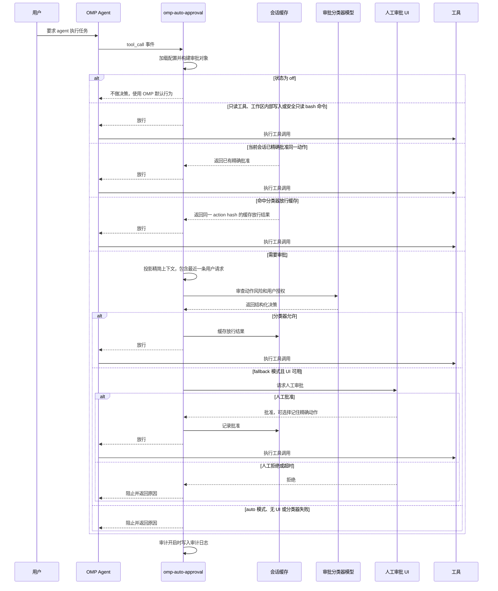

# omp-auto-approval

[English](./README.md) | 中文

omp-auto-approval 是 [pi-auto-approval](https://github.com/Europa2061/pi-auto-approval) 的 OMP 分支，提供受 Claude Code auto mode 和 Codex Auto-review 启发的自动审批功能。

当 OMP agent 请求执行工具调用时，扩展会用 AI 分类器判断能否安全放行。低风险动作会自动批准；高风险、拒绝、失败或不确定的动作，会按当前模式回退到人工审批或直接阻止。

## 安装

直接从 GitHub 安装此分支的最新版本：

```bash
omp plugin install https://github.com/sthetz/omp-auto-approval
```

安装固定为 `0.2.1` 的版本：

```bash
omp plugin install github:sthetz/omp-auto-approval#v0.2.1
```

原始 `0.1.0` 版本仍以 `omp-auto-approval` 的名称发布在 npm 上，但该包包含原始代码，而不是此恢复分支。此分支通过 GitHub 分发，不发布到 npm。

卸载插件：

```bash
omp plugin uninstall omp-auto-approval
```

重启 OMP RPC 进程并启用推荐模式：

```text
/auto-approval fallback
```

此分支和原版都会注册 `/auto-approval` 命令。启用本分支前请移除或禁用原版，避免命令重复注册。如需保留自定义设置，请先备份；本分支使用独立的配置和审计日志路径。

## 命令

`/auto-approval` 是唯一的斜杠命令。输入带尾随空格的 `/auto-approval ` 可以查看可用参数。

| 命令 | 效果 |
| --- | --- |
| `/auto-approval status` | 显示当前状态、审批分类器模型、配置文件路径和审计日志路径。 |
| `/auto-approval off` | 关闭自动审批。工具审批回到 OMP 的默认行为。 |
| `/auto-approval fallback` | 开启 AI 审批；当分类器拒绝或失败时，回退到人工审批。 |
| `/auto-approval auto` | 只使用 AI 审批。分类器拒绝或失败时直接阻止工具调用。 |
| `/auto-approval model` | 打开审批分类器模型选择器。 |
| `/auto-approval model current` | 使用当前 OMP 会话模型作为审批分类器模型。 |

## 截图

`/auto-approval` 参数补全会直接在 OMP 中展示可用模式和模型选择入口。


## 架构

omp-auto-approval 位于 OMP 工具调用和默认审批路径之间：

- 命令层注册 `/auto-approval` 并持久化本地配置；
- 路由层快速处理关闭、只读、工作区安全、会话已批准等动作；
- 分类器层投影最近会话上下文，并让选定模型返回结构化允许或拒绝决策；
- 兜底层在分类器无法安全放行时请求人工审批；
- 审计层在启用审计时写入 JSONL 记录。

## 审批流程



## 状态

`off` 表示扩展不做自动审批决策。

`fallback` 表示本地 fast path 会先处理已知低风险动作，例如可信只读工具、工作区内写入、显式 allowlist 的安全命令，或当前会话中已批准过的精确动作。其他工具调用会先交给分类器审批。如果分类器允许，工具会执行。如果分类器拒绝、失败、超时，或工具必须人工审批，并且 UI 可用，OMP 会通过审批 UI 询问人工确认。

`auto` 表示非 fast-path 工具调用由分类器作为审批关口。本地 fast path 仍然可以允许静态可证明低风险或当前会话已批准的动作。对于进入审批的动作，分类器允许时工具执行；分类器拒绝、失败、超时、工具必须人工审批，或连续拒绝过多时，工具调用会被阻止。

## 安全提示

普通交互使用推荐 `fallback`。它通过本地 fast path 和分类器减少重复确认，但分类器拒绝、失败或超时时仍会保留人工审批兜底。

`auto` 对进入审批的动作是失败即拒绝模式，只建议在可信的无人值守场景中使用。分类器失败或拒绝都会阻止工具调用。任何本地 fast path 都必须保持窄范围，并且能静态证明低风险；否则动作必须进入审批或被阻止。

## Fast Path

Fast path 不经分类器审批直接放行，因此范围刻意保持狭窄：

- **只读工具**：带可信只读元数据的工具，以及内置只读工具名（`read`、`grep`、`find`、`ls` 等）。
- **工作区写入**：`write` 和 `edit` 调用的所有目标路径（包括 `edit` 的重命名目标）都必须是工作目录内的普通路径。OMP 会在使用前改写的路径（`[path]`、`~/…`、`scheme://…`）以及受保护条目（任意层级、解析符号链接后的 `.git`、`.omp`、`.pi`、`.envrc`、`.vscode`）始终进入分类器审批，因为它们的内容会被直接执行或信任。例如 `.git/config` 中的 `core.fsmonitor` 会在 `git status` 时运行。
- **安全 bash 命令**：`pwd`、`git status`、`git log`、`git diff`、`git show`、`git rev-parse`、仅列出分支的 `git branch`，以及 `safeCommandAllowlist` 中的条目。包含换行、`&`、`|`、`;`、`<`、`>`、`` ` `` 或 `$` 的命令，以及使用 `--output` 或 `--ext-diff` 的 git 命令，永远不会走 fast path。

## 工具审批豁免

`todo` 和 `wait` 只执行本地编排，因此始终绕过分类器审批。其决策仍会写入审计日志，路由为 `local_state`。

`ask` 仅用于 UI。在交互会话中，不含 URL 的表单绕过分类器审批，审计路由为 `ui_only`；OMP 仍会渲染表单并等待提交或取消。渲染时会请求 HTTP(S) 图片地址，因此只要表单内容在 HTML 实体解码后任意位置包含 `http:`、`https:` 或 `//`，就仍需分类器审批。非交互式 `ask` 调用也需分类器审批。

`eval` 和 `task` 仍需分类器审批：`eval` 可执行任意代码，`task` 可将工作委派给具备完整能力的子代理。

在 `config.jsonc` 中设置 `reviewExemptTools`，可让其他工具名绕过扩展的全部审批：

```json
{
  "reviewExemptTools": ["custom_state"]
}
```

工具名不区分大小写。这是确定性的豁免，即使工具原本需要人工审批也会绕过，因此只应加入你允许其不经 AI 审批就执行的工具。相比之下，`allow` 只向分类器提示词添加指导，并不保证放行。

## 分类器模型

默认情况下，审批分类器使用当前 OMP 会话模型。使用 `/auto-approval model` 可以从 OMP 的模型选择器中选择另一个可用模型。

选中的值会保存为 `config.jsonc` 中的 `classifierModel`。`null` 表示“使用当前会话模型”。

分类器请求通过宿主自带的 `pi-ai` 包发出，并使用与 OMP 普通模型调用相同的 provider 鉴权，因此无需额外安装任何包。

模型选择器会先刷新 OMP runtime model registry，再读取可用模型，因此也会显示运行时添加的模型和自定义 provider。

## 参考来源

本扩展是独立的 OMP package。审批工作流和终端交互设计参考了 OpenAI Codex CLI 以及 Claude Code 风格的 coding-agent 权限流程。

## OMP Smoke 回归测试

运行本地 OMP 侧 smoke 回归测试：

```bash
npm run smoke:omp
```

该脚本会在临时配置和日志目录中运行，验证 `/auto-approval fallback`、`/auto-approval auto`、安全 bash 命令放行、可疑 bash 命令的人工兜底或拒绝，以及 JSONL 审计日志内容。
