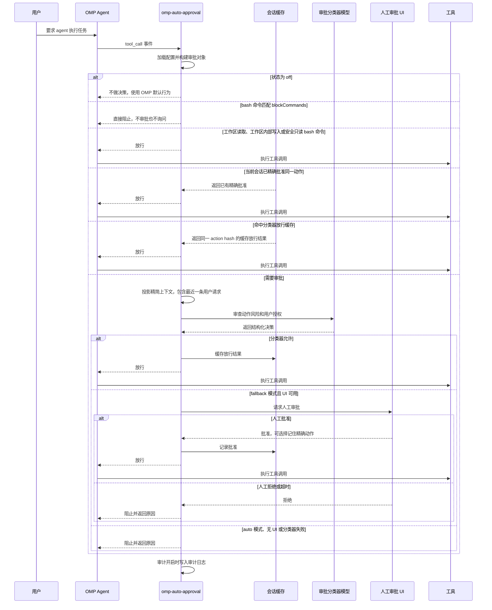

# omp-auto-approval

[English](./README.md) | 中文

omp-auto-approval 是 [pi-auto-approval](https://github.com/Europa2061/pi-auto-approval) 的 OMP 分支，提供受 Claude Code auto mode 和 Codex Auto-review 启发的自动审批功能。

当 OMP agent 请求执行工具调用时，扩展会用 AI 分类器判断能否安全放行。低风险动作会自动批准；高风险、拒绝、失败或不确定的动作，会按当前模式回退到人工审批或直接阻止。

## 安装

直接从 GitHub 安装此分支的最新版本：

```bash
omp plugin install https://github.com/sthetz/omp-auto-approval
```

安装固定为 `0.3.0` 的版本：

```bash
omp plugin install github:sthetz/omp-auto-approval#v0.3.0
```

原始 `0.1.0` 版本仍以 `omp-auto-approval` 的名称发布在 npm 上，但该包包含原始代码，而不是此恢复分支。此分支通过 GitHub 分发，不发布到 npm。

卸载插件：

```bash
omp plugin uninstall omp-auto-approval
```

重启 OMP RPC 进程并启用推荐模式：

```text
/auto-approval fallback
```

OMP 自带审批设置 `tools.approvalMode`，它在本扩展放行调用之后运行。默认值 `yolo` 不会额外询问。若设为 `always-ask`、`always-ask-cached` 或 `write`，OMP 仍会对本扩展已批准的调用再次询问你。

此分支和原版都会注册 `/auto-approval` 命令。启用本分支前请移除或禁用原版，避免命令重复注册。如需保留自定义设置，请先备份；本分支使用独立的配置和审计日志路径。

## 命令

`/auto-approval` 是唯一的斜杠命令。输入带尾随空格的 `/auto-approval ` 可以查看可用参数。

| 命令 | 效果 |
| --- | --- |
| `/auto-approval status` | 显示当前状态、审批分类器模型、配置文件路径、审计日志路径以及配置问题。 |
| `/auto-approval off` | 关闭自动审批。工具审批回到 OMP 的默认行为。 |
| `/auto-approval fallback` | 开启 AI 审批；当分类器拒绝或失败时，回退到人工审批。 |
| `/auto-approval auto` | 只使用 AI 审批。分类器拒绝或失败时直接阻止工具调用。 |
| `/auto-approval model` | 打开审批分类器模型选择器。 |
| `/auto-approval model current` | 使用当前 OMP 会话模型作为审批分类器模型。 |
| `/auto-approval explain <tool> [args]` | 显示某个工具调用会走哪条审批路由，但不执行它。`args` 可以是路径、JSON 对象，或（对 `bash`）命令，例如 `/auto-approval explain read ~/.ssh/id_ed25519`。如果第一个单词不是当前会话中的工具，整段输入会被当作 bash 命令解释：`/auto-approval explain ls -la`。 |

## 截图

`/auto-approval` 参数补全会直接在 OMP 中展示可用模式和模型选择入口。


## 架构

omp-auto-approval 位于 OMP 工具调用和默认审批路径之间：

- 命令层注册 `/auto-approval` 并持久化本地配置；
- 提示词层在自动审批开启时向系统提示词追加一段简短说明，要求代理在调用被阻止时如实报告，而不是换一种方式重试；
- 路由层快速处理关闭、工作区只读、工作区安全、会话已批准等动作；
- 分类器层投影最近会话上下文，并让选定模型返回结构化允许或拒绝决策；
- 兜底层在分类器无法安全放行时请求人工审批；
- 审计层在启用审计时写入 JSONL 记录。

## 审批流程



## 状态

`off` 表示扩展不做自动审批决策。

`fallback` 表示本地 fast path 会先处理已知低风险动作，例如非敏感的工作区读取、工作区内写入、显式 allowlist 的安全命令，或当前会话中已批准过的精确动作。其他工具调用会先交给分类器审批。如果分类器允许，工具会执行。如果分类器拒绝、失败、超时，或工具必须人工审批，并且 UI 可用，OMP 会通过审批 UI 询问人工确认。

`auto` 表示非 fast-path 工具调用由分类器作为审批关口。本地 fast path 仍然可以允许静态可证明低风险或当前会话已批准的动作。对于进入审批的动作，分类器允许时工具执行；分类器拒绝、失败、超时，或工具必须人工审批时，工具调用会被阻止。

### 结束当前轮次

连续出现 `maxConsecutiveDenials` 次自动拒绝（默认 3 次：分类器拒绝或失败，以及 `blockCommands` 阻止）后，扩展会直接结束代理的当前轮次，而不是指望代理自己停下。`fallback` 模式下的人工审批界面也提供 **Reject and Stop the Turn**。

自动审批开启时，系统提示词中会追加一段简短说明，要求代理在调用被阻止时向你报告，而不是换一种方式重试。

## 安全提示

普通交互使用推荐 `fallback`。它通过本地 fast path 和分类器减少重复确认，但分类器拒绝、失败或超时时仍会保留人工审批兜底。

`auto` 对进入审批的动作是失败即拒绝模式，只建议在可信的无人值守场景中使用。分类器失败或拒绝都会阻止工具调用。任何本地 fast path 都必须保持窄范围，并且能静态证明低风险；否则动作必须进入审批或被阻止。

## Fast Path

Fast path 不经分类器审批直接放行，因此范围刻意保持狭窄：

- **工作区读取**：宿主自带的只读工具（`read`、`grep`、`find`、`glob`、`ast_grep`、`ls` 等），且其指定的每个路径（解析符号链接后）都位于工作目录或 `readRoots` 目录内、并且不像凭据文件。以下情况始终进入分类器审批：
  - 工作目录和 `readRoots` 之外的路径；
  - URL（`http(s)://`、`www.`）以及远程或敏感的内部 URL（`ssh://`、`mcp://`、`pr://`、`issue://`、`mr://`、`vault://`、`cfg://`、`proc://` 等）。只有会话本地 URL（`skill://`、`rule://`、`agent://`、`artifact://`、`memory://`、`local://`、`omp://`）可以跳过审批；
  - 目录树中任意位置的凭据类文件和目录：`.env` 和 `.env.*`（`.example`、`.sample`、`.template`、`.dist`、`.defaults` 除外）、`.envrc`、`.npmrc`、`.pypirc`、`.netrc`、`.pgpass`、`.git-credentials`、`.htpasswd`、`kubeconfig`、`id_rsa`/`id_ed25519` 类私钥、`credentials.*`、`secret(s).*`、`*.pem`、`*.key`、`*.p12`、`*.pfx`、`*.jks`、`*.keystore`、`*.kdbx`、`*.tfstate`、`*.tfvars`，以及 `.ssh`、`.gnupg`、`.aws`、`.azure`、`.kube`、`.docker`、`.password-store`、`secrets`、`.secrets`、`credentials` 目录下的任何内容；
  - OMP 会在使用前改写的路径形式（开头的 `@`、`:` 或 `"`，`~user`，`file://`，`?query`，`#fragment`）；
  - 设置了 `gitignore: false` 的搜索。OMP 的 `grep` 会搜索隐藏文件，但遵守 `.gitignore`，因此通常不会在全工作区搜索中读到 `.env`。*未*被 gitignore 的密钥文件仍可能出现在 grep 结果中。

  `web_search` 始终需要分类器审批，因为它的查询会发送给第三方，可能把数据带出会话。

  只有宿主报告为自身工具（`sourceInfo.source` 为 `builtin`）时才按工具名匹配。扩展、SDK 或 MCP 工具即使复用了只读工具名也需要审批。工具自行声明的元数据（`isReadOnly`、`readOnlyHint`、MCP `annotations.readOnlyHint`）会被忽略，因为 MCP 规范说明这些提示不可信。
- **工作区写入**：OMP 自身的 `write` 和 `edit` 工具调用，且所有目标路径（包括 `edit` 的重命名目标）都是工作目录内的普通路径。以下情况始终进入分类器审批：
  - OMP 会在使用前改写的路径（`[path]`、`~/…`、`scheme://…`）；
  - 任意层级、解析符号链接后的受保护条目：`.git`、`.omp`、`.pi`、`.claude`、`.mcp.json`、`.cursor`、`.envrc`、`.vscode`、`.idea`、`.husky`、`.devcontainer`。它们的内容之后会被直接执行或信任：`.git/config` 中的 `core.fsmonitor` 会在 `git status` 时运行，`.claude/settings.json` 中的 Claude Code hooks 会执行 shell 命令；
  - 上文读取部分列出的凭据类文件，例如 `.env` 或 `*.pem`。
- **安全 bash 命令**：`pwd`、`git status`、`git log`、`git diff`、`git show`、`git rev-parse`、仅列出分支的 `git branch`，以及 `safeCommandAllowlist` 中的条目。包含换行、`&`、`|`、`;`、`<`、`>`、`` ` `` 或 `$` 的命令永远不会走 fast path。以下 git 命令也不会：
  - 使用 `--output`、`--ext-diff` 或 `--no-index`；
  - 指定工作目录之外的路径（即使不加 `--no-index`，git 也会比较工作树之外的文件，因此 `git diff /etc/passwd /dev/null` 会输出该文件）；
  - 指定凭据类路径，包括 `git show HEAD:.env` 这类 `rev:path` 对象。

### allowlist 中的命令

`safeCommandAllowlist` 条目是前缀（`"rg *"`、`"find"`、`"npm test"`），单靠它会信任该程序的所有选项。即使条目匹配，以下命令仍需审批：

- 使用会运行其他程序或写文件的选项：`find -exec/-execdir/-ok/-okdir/-delete/-fprint*/-fls`、`fd -x/-X/--exec*`（包括 `-Hx` 这样的组合）、`rg --pre`、`sort -o/--output/--compress-program`、`tar -I/-F/--to-command/--checkpoint-action/--use-compress-program/...`，以及解包或写入归档的 `tar`（`x`、`c`、`r`、`u`、`A`、`--extract`、`--delete` 等）。GNU 工具接受缩写的长选项，因此 `sort --outp=x` 等同于 `--output`；
- 参数指向工作目录和 `readRoots` 之外的已存在路径，或凭据类路径。这也包括紧跟在选项后的值和 `name=value` 形式的参数：`cat ~/.ssh/id_ed25519`、`cat .env`、`rg TOKEN --file=../x`、`grep -f/etc/x`、`dd if=../x`；
- 参数会被 shell 展开，因为其最终形式未知：未加引号的通配符或花括号、`~user`，或 `name=value` 形式中 `=` 或 `:` 之后的 `~`（bash 会展开它，例如 `dd if=~/key`）。`cat secrets*` 需要审批，`find . -name '*.ts'` 不需要。

有些条目会被忽略，`/auto-approval status` 会提示：参数本身就是脚本或命令行的程序（`sed`、`awk`、`xargs`、`parallel`）的任何条目，以及 shell、解释器和包装命令（`bash`、`python`、`node`、`env`、`sudo`、`timeout` 等）的裸条目，因为它们等于允许任意代码。请改为写出具体调用，例如 `"python -m pytest"` 或 `"npm test"`。除这些规则外，条目仍然信任该程序：`npm test` 会运行 `test` 脚本中的任何内容。

### 额外的可读目录

工作目录之外的读取需要审批，因此读取依赖源码等内容时会多一次分类器调用。可以把允许代理自由读取的目录写入 `readRoots`：

```json
{
  "readRoots": ["/nix/store", "~/.cargo/registry", "~/go/pkg/mod"]
}
```

条目必须是绝对路径或以 `~/` 开头。可读目录下的凭据类文件仍需审批。`readRoots` 只作用于只读工具，不作用于 bash 命令。

## 阻止的命令

`blockCommands` 列出的 bash 命令在任何模式下都会被直接阻止，既不询问分类器，也不询问你。它优先于所有 fast path、`safeCommandAllowlist` 和 `reviewExemptTools`。`deny` 只是给分类器的指导，而这里的阻止无法被说服。

```json
{
  "blockCommands": ["git push --force", "git push -f", "/\\bgit\\b.*\\bpush\\b.*\\s\\+\\S/", "terraform apply", "/curl[^|]*\\|\\s*(ba)?sh/"]
}
```

模式可以是 `/regex/flags`（对整条命令做匹配），也可以是一串单词：第一个单词是程序名，其余单词需按顺序出现在同一条命令中。`git push --force` 能匹配 `git push origin main --force`、`/usr/bin/git push --force`、`cd repo && git push --force` 和 `bash -lc "git push --force"`，但不匹配 `git push --force-with-lease`。长参数按字面比较，因此 `-f` 需要单独列出。单字母参数也能匹配合并的短参数：`git push -f` 能匹配 `git push -uf origin main`。在分支前加 `+`（`git push origin +main`）同样会强制推送，单词列表无法表达这种形式，上例中的正则表达式可以捕获它。匹配倾向于阻止：这些单词作为其他命令的参数出现时（例如 `echo git push --force`）也会匹配。

这只是针对你绝不希望无人值守执行的命令的尽力而为的绊线，而不是沙箱：足够“有创意”的命令（变量、别名、脚本）仍可能绕过它，此时会照常由分类器审批。

## 工具审批豁免

`todo` 和 `wait` 只执行本地编排，因此宿主自带的 `todo` 和 `wait` 始终绕过分类器审批。其决策仍会写入审计日志，路由为 `local_state`。

`ask` 仅用于 UI。在交互会话中，宿主自带 `ask` 中不含 URL 的表单绕过分类器审批，审计路由为 `ui_only`；OMP 仍会渲染表单并等待提交或取消。渲染时会请求 HTTP(S) 图片地址，因此只要表单内容在 HTML 实体解码后任意位置包含 `http:`、`https:` 或 `//`，就仍需分类器审批。非交互式 `ask` 调用也需分类器审批。

`eval` 和 `task` 仍需分类器审批：`eval` 可执行任意代码，`task` 可将工作委派给具备完整能力的子代理。

在 `config.jsonc` 中设置 `reviewExemptTools`，可让其他工具名绕过扩展的全部审批：

```json
{
  "reviewExemptTools": ["custom_state"]
}
```

工具名不区分大小写。这是确定性的豁免，即使工具原本需要人工审批也会绕过，因此只应加入你允许其不经 AI 审批就执行的工具。相比之下，`allow` 只向分类器提示词添加指导，并不保证放行。`blockCommands` 对豁免工具同样生效。

## 分类器模型

默认情况下，审批分类器使用当前 OMP 会话模型。使用 `/auto-approval model` 可以从 OMP 的模型选择器中选择另一个可用模型。

选中的值会保存为 `config.jsonc` 中的 `classifierModel`。`null` 表示“使用当前会话模型”。

分类器请求通过宿主自带的 `pi-ai` 包发出，并使用与 OMP 普通模型调用相同的 provider 鉴权，因此无需额外安装任何包。

模型选择器会先刷新 OMP runtime model registry，再读取可用模型，因此也会显示运行时添加的模型和自定义 provider。

分类器能看到最新的用户请求、最多六条较早的用户消息、代理的最新消息以及待审批的动作。授权只能来自你的消息。代理的消息用于说明意图，但被标记为不可信。工具输出（文件内容、命令输出、抓取的网页）完全不会提供给分类器，因为提示词注入正是从这里来的。

OMP 代替他人放入 user 角色的消息（`attribution: "agent"`）不算作你的消息：子代理的任务分配、压缩和分支摘要、来自其他代理的消息以及 MCP 通知。分类器会单独看到其中最新的一条，并标记为不可信。否则代理可以在 `task` 分配中写入“用户已批准”，子代理的分类器就会把它当成你的请求。对于子代理，你的消息取自父会话文件（通过 `parentSession` 头找到）。使用 `--no-session` 时没有该文件，子代理看不到用户请求，只有低风险动作会被放行。

如果分类器放行了一个它自己评为 `high` 风险、但用户授权不是 `high` 的动作，或任何未获 `high` 授权的 `critical` 风险动作，扩展会将其视为拒绝。

### 分类器超时

当扩展的 `tool_call` 处理器运行时间超过 `extensionHandlers.toolCallTimeoutMs`（默认 30 秒）时，OMP 会直接阻止该工具调用：分类器还没给出结果，即使在 `fallback` 模式下也不会询问你。根据该设置的说明，在 OMP 自身对话框（例如审批界面）中等待的时间不计入。因此 `classifierTimeoutSeconds` 默认是 25 秒：较慢的分类器会先超时，于是 `fallback` 会询问你，`auto` 会给出明确原因并阻止。

如果使用较慢的分类器模型，请同时调高两者：OMP 的 `extensionHandlers.toolCallTimeoutMs`，以及低于它的 `classifierTimeoutSeconds`。当 `classifierTimeoutSeconds` 为 30 秒或更长时，`/auto-approval status` 会给出警告。0.3.0 之前默认值是 90 秒，并且会写入每个配置文件；现在读取到的 90 会被视为 25。

## 配置

`config.jsonc` 位于扩展目录中，或由 `PI_AUTO_APPROVAL_CONFIG_PATH` 指定。只保存与默认值不同的配置，因此以后默认值的变化会生效。`/auto-approval status` 会报告未知的键（例如拼写错误）。完整 schema 见 [`schemas/config.schema.json`](schemas/config.schema.json)，带注释的示例见 [`config/config.example.jsonc`](config/config.example.jsonc)。

| 键 | 默认值 | 含义 |
| --- | --- | --- |
| `enabled`、`mode` | `false`、`"fallback"` | 由 `/auto-approval off / fallback / auto` 设置。 |
| `classifierModel` | `null` | `provider/model`，或 `null` 表示使用会话模型。 |
| `classifierTimeoutSeconds` | `25` | 见[分类器超时](#分类器超时)。 |
| `approvalTimeoutSeconds` | `30` | 人工审批界面等待多久后视为拒绝。 |
| `maxConsecutiveDenials` | `3` | 连续自动拒绝多少次后结束当前轮次。 |
| `safeCommandAllowlist` | `[]` | 额外允许免审批的 bash 命令：完全匹配、前缀加空格，或 `prefix*`。见[allowlist 中的命令](#allowlist-中的命令)。 |
| `blockCommands` | `[]` | 见[阻止的命令](#阻止的命令)。 |
| `readRoots` | `[]` | 见[额外的可读目录](#额外的可读目录)。 |
| `reviewExemptTools` | `[]` | 完全跳过审批的工具名。 |
| `allow`、`deny` | `[]` | 给分类器提示词的额外指导。 |
| `environment` | `""` | 给分类器的自由格式环境说明。 |
| `audit` | `true` | 将决策以 JSONL 写入审计日志。 |

## 参考来源

本扩展是独立的 OMP package。审批工作流和终端交互设计参考了 OpenAI Codex CLI 以及 Claude Code 风格的 coding-agent 权限流程。

## OMP Smoke 回归测试

运行本地 OMP 侧 smoke 回归测试：

```bash
npm run smoke:omp
```

该脚本会在临时配置和日志目录中运行，验证 `/auto-approval fallback`、`/auto-approval auto`、安全 bash 命令放行、可疑 bash 命令的人工兜底或拒绝，以及 JSONL 审计日志内容。
